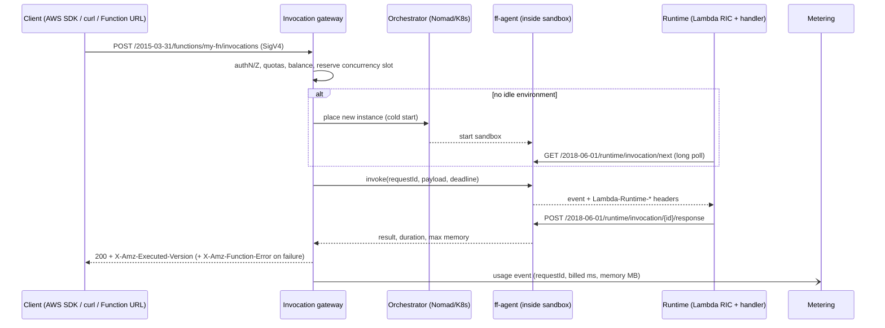
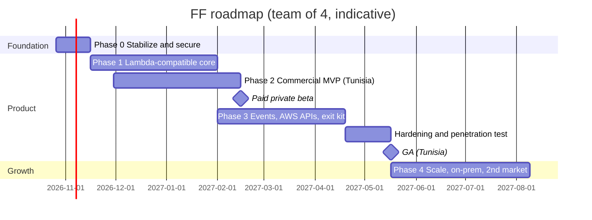

# FF (Function Flow): Plan for Local-Payment Markets and Lock-In-Free Migration to AWS

| | |
|---|---|
| **Status** | Draft v1, for review |
| **Date** | 2026-10-16 |
| **Scope** | Whole repository: `BE/`, `FE/`, `cli/`, `cli-rust/`, `BE/templates/`, `docs/`, `scripts/`, `docker-compose.yml`, `infrastructure/`, `nomad-vagrant/` |
| **Goal** | Make FF sellable in Tunisia and in other markets where customers cannot easily pay international cloud providers, and guarantee that customers can later move to AWS Lambda (or other clouds) without rewriting code |

> **How to read this.** §0 is the one-page summary. §1–§3 explain the market, the current state of the code, and the strategy. §4–§11 are the workstreams, each with concrete tasks and exit criteria. §12 is the phased roadmap with effort, §13–§15 cover KPIs, risks, and open decisions, and §16 is the first 10 working days. The appendices hold the reference material: findings mapped to fixes, the compatibility matrix, the environment-variable contract, event payloads, the data model, interface sketches, payment providers, expansion markets, and sources. Facts about regulation, providers, and licences were researched on 2026-10-16. Confirm each one with the source (and with a lawyer or accountant where marked) before relying on it commercially.

---

## 0. Summary

**Product promise:** *"Build serverless apps on FF, hosted in Tunisia and paid in dinars. When you outgrow us, your functions run on AWS Lambda unchanged."*

**Why customers will buy** (§1.1). Buying AWS directly from Tunisia means:
- exchange-control paperwork;
- a card allowance of 1,000 TND a year for individuals;
- 19% reverse-charge VAT, plus possibly 15% withholding tax;
- authorization from the data-protection authority before personal data leaves the country.

Buying from FF is one TND invoice, with nothing leaving Tunisia.

1. **Today FF is a working prototype, not yet a product.**
   - Authentication is switched off, and every function belongs to a hard-coded user `'1'`.
   - Delete and update never reach Nomad, so deleted functions keep running.
   - User code is injected into Nomad *templates*, so it is evaluated as a template on the Nomad client.
   - The database migrations don't match the entities. It only works today because schema sync is on; a production database would break.
   - The console doesn't build, and there are no tests.
   - Details are in §2.
2. **Compatibility strategy: implement AWS's public contracts instead of inventing FF ones.**
   - Run every function through the **Lambda Runtime API**, served by a small agent inside each sandbox. AWS's own runtime interface clients and Lambda base images then work unchanged.
   - Accept the **Lambda zip and OCI image formats**.
   - Deliver the **same event payloads** AWS does (Function URL/API Gateway v2, SQS, S3, EventBridge).
   - Expose a **Lambda-compatible REST API with SigV4**, so the AWS CLI, the AWS SDKs, and Terraform work by changing only the endpoint.
   - Details are in §3, §4, and §6.
3. **Commercial strategy: prepaid-first billing in TND through local payment rails.**
   - Usage is metered in **exactly Lambda's units** (requests and GB-seconds). Customers can compare, and forecast their future AWS bill.
   - No Tunisian gateway documents automatic card renewals, so customers buy **prepaid credit**. Launch with Konnect, Flouci, and bank transfer.
   - B2B customers get legally compliant Tunisian invoices: VAT, stamp duty, withholding-tax handling, and **El Fatoora e-invoicing, which has been mandatory for service providers since 2026**.
   - Details are in §8.
4. **Make leaving easy and say so openly.**
   - `ff export` generates an AWS SAM template and Terraform for the customer's whole stack.
   - It also produces data-migration scripts and an estimate of the cost on AWS.
   - A conformance suite proves compatibility on every release, against AWS's own Runtime Interface Emulator and periodically against real Lambda.
   - Details are in §6.10 and §7.
5. **Resolve two upstream problems before selling.**
   - **Nomad** is under the Business Source License (BUSL 1.1), now with IBM as licensor. A hosted FaaS that only uses Nomad internally is *plausibly* allowed, but this is unsettled. An on-prem product that bundles Nomad fits the licence's definition of "embedding". **Decided 2026-10-16: move to Kubernetes** ([ADR 0001](adr/0001-orchestrator-kubernetes.md), [migration plan](kubernetes-migration-plan.md)).
   - **MinIO's community edition is discontinued**: the repository was archived in April 2026, and its Docker images disappeared from Docker Hub in September 2026. FF's `docker-compose.yml` therefore can't even start on a fresh machine (H-12). Replace it now (ADR-002).
   - Details are in §4.10 and §9.5.

**Roadmap** (≈ 90 person-weeks to GA, plus 25% contingency; team of 4; details in §12):

| Phase | Duration | Outcome |
|---|---|---|
| 0. Stabilize and secure | 3 weeks | Auth on, tenancy, no template injection, migrations fixed, CI and tests, console builds |
| 1. Lambda-compatible core | ≈ 11 weeks | Lambda zips and images run unchanged (L1/L2), sandboxing, multi-tenant IAM, logs, single CLI |
| 2. Commercial MVP (Tunisia), overlaps Phase 1 | ≈ 11 weeks | Metering, wallet, 2 local payment providers + bank transfer, legal invoices, FR/AR/EN console |
| *Paid private beta* | ≈ week 17 (mid-Feb 2027) | 5–10 pilot customers paying in TND |
| 3. Events, AWS APIs, exit kit | ≈ 11 weeks + 4 hardening | Function URLs/custom domains, schedules, async, S3/SQS-compatible services, Lambda API + SigV4, Terraform, `ff export` |
| *General availability* | ≈ week 30 (mid-May 2027) | Public launch in Tunisia; about 2–3 months later with a team of 3 |
| 4. Scale and expand | 12+ weeks | HA/DR, cold-start work, more runtimes, dedicated/on-prem edition, second market |

---

## 1. Market context and assumptions

### 1.1 The problem FF solves

A Tunisian developer or company that wants to buy AWS, GCP, or Azure directly runs into five separate obstacles. The status below is as of October 2026; the bracketed codes refer to Appendix J.

| Obstacle | What it means in practice |
|---|---|
| **Exchange law.**<br>• The 1976 exchange code (Law 76-18) still applies: payments abroad must go through an approved intermediary (a bank or La Poste) [T12, T16].<br>• The reform bill 115/2025, which would free current payments, was **not adopted** as of mid-October 2026 [T16, T17]. | Every foreign payment needs paperwork. |
| **Card allowances.** The *Carte Technologique Internationale* allows:<br>• **1,000 TND/year** for an individual;<br>• **10,000 TND/year** for a company;<br>• **100,000 TND/year** for a company with the Startup Act label [T12–T14].<br>A raise announced in May 2025 had not been enacted by September 2026 [T15, T16]. | 1,000 TND a year (a few hundred US dollars) must cover *all* of an individual's online purchases abroad. A production workload can exhaust a company's allowance. |
| **Company wire transfers.** Allowed under BCT circular 2016-09 for hosting, subscriptions, and software licences on invoice. However:<br>• payments must be domiciled at a single bank;<br>• original documents are required;<br>• transfers must be net of Tunisian taxes;<br>• a tax-clearance certificate is needed where required [T12]. | Variable monthly cloud bills are painful to pay by wire. |
| **Tax on non-resident suppliers.** AWS invoices Tunisian accounts from AWS EMEA SARL (Luxembourg) [T39].<br>• The Tunisian buyer withholds **100% of the 19% VAT** (reverse charge). This is a pure cost for buyers not registered for VAT [T21].<br>• Depending on how the service is classified, **15% withholding tax** may apply to payments to non-residents. The treaty with Luxembourg may reduce it; the classification is unverified [T18].<br>• If the supplier insists on receiving the full amount, the buyer must gross up by ≈ 17.6%. | AWS costs materially more than its list price, once taxes and administration are counted. |
| **Data protection and sector rules.**<br>• Sending personal data abroad requires **authorization from INPDP**, the data-protection authority (Law 2004-63, art. 52). Unauthorized transfers are a criminal offence (art. 90) [T26].<br>• INPDP's council mandate expired in April 2024, and no renewal has been confirmed [T27].<br>• Banks need prior BCT authorization to outsource customer data (circular 2006-01) [T29].<br>• Public bodies must use State-approved hosting [T30–T32]. | Hosting customer data on AWS is a compliance project in itself. |

The local alternative is one TND invoice with deductible 19% VAT and a 1 TND stamp duty. There is no exchange-control file and no cross-border data-transfer authorization [T18, T19, T21].

**This is FF's real advantage.** The pitch is not only "you can pay us". It is "buying from us is simpler, cheaper all-in, and compliant by default, and you can still leave for AWS whenever you want."

What these customers need:
- A modern serverless platform they can pay for **locally**, with invoices their accountant accepts.
- Their data hosted **in-country**, with low latency.
- Support in **French and Arabic**.
- No trap: their skills and code must transfer to AWS when they grow. Lambda is what they learn from tutorials, courses, and job postings.

### 1.2 Assumptions (change any of these and the plan adapts)

| # | Assumption |
|---|---|
| A1 | FF is operated by a Tunisian legal entity, hosted in Tunisian data centers, and bills in TND. |
| A2 | The primary edition is multi-tenant SaaS (**FF Cloud**). Secondary editions are **FF Dedicated** (single-tenant, hosted by FF) and **FF On-Prem** (licensed to banks, telcos, and government), all sold through B2B contracts. |
| A3 | First customers: startups, agencies, freelancers, SMEs, students, and universities. Enterprise and public sector come later. |
| A4 | Team: 3–4 engineers, plus part-time legal, accounting, and design help. |
| A5 | v1 runtimes: Node.js and Python (as today). Java, .NET, Go, and Rust come later via custom runtimes. |
| A6 | AWS Lambda is the primary migration target. Other clouds are reached through open standards (OCI, OpenTelemetry, CloudEvents, Terraform/OpenTofu). |

### 1.3 Non-goals for v1
- Full AWS emulation: CloudFormation, IAM policy-language parity, Step Functions, VPC networking, X-Ray, DynamoDB.
- General IaaS (VMs, managed Kubernetes for customers).
- Crypto or stablecoin payments. These are regulatory risk and unnecessary for the target market.

---

## 2. Current state review (code audit)

### 2.1 What exists today

```
Browser (React 19 + Vite, FE/) ──HTTP──▶ NestJS 10 API (BE/) ──▶ PostgreSQL (TypeORM)
                                           ├─▶ MinIO: <fnId>/code.ts, package.json, tsconfig.json
                                           └─▶ Nomad HTTP API: one service job per function
                                                  docker driver, image node:18-alpine
                                                  container start: npm install -g ts-node … && npm install && ts-node wrapper.ts
Invoke: API ─▶ Nomad /job/<id>/allocations ─▶ allocations[0] ─▶ http://<nomad-host>:<dynamic-port>/invoke
CLIs (cli/ Node, cli-rust/ Rust) ─▶ MinIO directly with storage credentials (not connected to the API)
Monitoring: prom-client registry (never written to) · Grafana JSON · function_metrics table · in-process autoscaler
```

### 2.2 What is already good (keep it)
- **Clean NestJS module split** (functions, nomad, minio-client, metrics, monitoring, auth). `BE` type-checks cleanly (`tsc --noEmit` exits 0).
- **The handler is already Lambda-shaped:** `export async function handler(event, context)`, with `functionName`, `functionVersion`, `memoryLimitInMB`, and `getRemainingTimeInMillis()` (`BE/templates/nodejs/wrapper.ts`). The "Lambda feel" is there; it now needs to become *exact*.
- **S3-compatible object storage** is the right abstraction for code artifacts and customer storage.
- **Nomad bridge networking**, with dynamic ports and a network namespace per allocation, is a usable base for sandboxing.
- **Written specs** for auto-scaling and CLI authentication (`docs/auto-scaling-feature.md`, `docs/cli-authentication-spec.md`). They are folded into this plan. Both files were later removed with the other outdated documents; git history has them.

### 2.3 Findings

Severity levels:
- **C** (critical): a security hole, or it blocks selling.
- **H** (high): a core flow is broken.
- **M** (medium).
- **L** (low).

Appendix A maps every finding to its fix and phase.

| ID | Sev | Where | Finding | Consequence |
|---|---|---|---|---|
| C-1 | C | `BE/src/functions/functions.controller.ts:24-25` | The JWT guard is commented out, and no global guard exists. | Every endpoint is public: anyone can create, read, update, and invoke functions. |
| C-2 | C | `BE/src/functions/functions.service.ts:29` | `userId: '1'` is hard-coded on create. Without a guard, `@User()` returns `undefined`. | There is no tenancy: all functions belong to one user. `update`/`remove` compare against `undefined` and always fail (`functions.controller.ts:63,74`). |
| C-3 | C | `functions.controller.ts:48-50, 89-91, 105-107, 119-121`, `BE/src/metrics/metrics.controller.ts:8-19` | Ownership checks are commented out on read, invoke, invocations, and scaling; the metrics route has none. | Insecure direct object references: any function ID can be read or invoked, and other tenants' inputs and outputs leak. |
| C-4 | C | `BE/src/nomad/nomad.service.ts:280-297` | User code is shipped as a Nomad `EmbeddedTmpl` (consul-template). | Code containing `{{ … }}` is **evaluated by consul-template on the Nomad client**. A tenant can call `env`, `key`, `service`/`nomadService`, `nomadVar`, or `secret` to read the task environment, the service catalog, Consul KV, and any Nomad or Vault variables in scope. This is template injection, and it also breaks legitimate code containing `{{`. |
| C-5 | C | `nomad.service.ts:77-90` | `updateFunction` and `removeFunction` are no-ops. | Deleted functions keep running and costing money (a security and cost leak). Code updates are never deployed. |
| C-6 | C | `nomad.service.ts:34-39, 266-305` | Containers run as root on a stock image with no gVisor/seccomp profile, no read-only rootfs, no capability drop, unrestricted egress, and no tenant network policy. Nomad is called without an ACL token, over plain HTTP. | Untrusted multi-tenant code can attack the host, Nomad, MinIO, PostgreSQL, and other tenants. |
| C-7 | C | `BE/src/migrations/*`, `*.entity.ts`, `BE/src/config/configuration.ts:9` | The schema only works because `synchronize` is on outside production. In the migrations:<br>• `function_metrics` has different columns from its entity.<br>• The status enum lacks `RUNNING`/`COMPLETED`.<br>• `cpuUsed` and `updatedAt` are missing.<br>• `memoryUsed` is `NOT NULL`.<br>• `uuid_generate_v4()` is used without creating `uuid-ossp`.<br>`BE/logs/error.log` shows the resulting errors. | A production deploy (migrations, no sync) fails on first use. |
| H-1 | H | `nomad.service.ts:352-360` | Every container start runs `npm install -g ts-node typescript` and `npm install`. | Cold starts take tens of seconds, workers need internet access to npm, and it adds supply-chain risk. |
| H-2 | H | `nomad.service.ts:276-279` | `MemoryMB: 512` is hard-coded and `function.memory` is ignored; CPU is not proportional to memory. | Limits and future billing don't match the configuration; noisy neighbours. |
| H-3 | H | `nomad.service.ts:96-132` | Invoke takes `allocations[0]` (which may be dead) and calls `http://<host>:<port>/invoke` directly, with no timeout, no retry, and no load balancing. | Random failures and hung requests; the function can't scale beyond one instance. |
| H-4 | H | `nomad.service.ts:136-137` | CPU and memory are read from `/v1/allocation/:id`, which has no live stats (those are on `/v1/client/allocation/:id/stats`). | `memoryUsed`/`cpuUsed` are always empty, so metrics and usage data are wrong. |
| H-5 | H | `functions.service.ts:131-150` | The invocation `duration` is computed but never saved; the column stays `0`. | There is no basis for metering or billing. |
| H-6 | H | `nomad.service.ts:271-297, 341-360` | For Python, the image is `python:3.9-alpine`, but the command is `npm …` and files are written as `function.ts`/`wrapper.ts`. | The Python runtime cannot work. |
| H-7 | H | `BE/src/metrics/metrics.service.ts:20, 61-135` | The autoscaler runs inside the API process:<br>• Metric windows live in memory: lost on restart, wrong with more than one replica.<br>• `requestCount / activeInstances` can divide by zero.<br>• Scale-up is unbounded.<br>• `min`/`maxInstances` and `scaleToZero` are ignored.<br>• CPU *ticks* are compared to a *percentage*. | Unstable scaling and runaway cost under real traffic. |
| H-8 | H | `BE/templates/nodejs/wrapper.ts:77` | `console.log({ env: process.env })` at startup. | Every env var, including future secrets, ends up in the logs. |
| H-9 | H | `wrapper.ts:20, 54-57` | The remaining time is measured from *process* start, not invocation start, and the timeout is never enforced. | Wrong semantics compared with Lambda; runaway executions. |
| H-10 | H | `cli/src/services/minio.service.ts:7-27`, `cli-rust/src/minio.rs:11-44` | Both CLIs upload zips straight to MinIO with storage credentials, and the backend never reads those zips. | Storage root credentials would be handed to customers, and "deploy" doesn't deploy. |
| H-11 | H | `FE/src/services/api.ts:4, 11-17, 100-103`, `FE/src/components/FunctionDetail.tsx:33, 88` | Problems in the console:<br>• The API URL is hard-coded to `localhost`.<br>• A token is read from `localStorage`, but no login exists.<br>• Invocations shape mismatch: the API returns `{invocations,total}`, the UI expects an array.<br>• "Update" posts the whole entity, which `forbidNonWhitelisted` rejects (`BE/src/main.ts:32`).<br>• `PUT …/scaling-config` doesn't exist.<br>• `tsc -b` fails with 2 errors, so `npm run build` fails. | The console cannot be shipped. |
| H-12 | H | `docker-compose.yml:16`, `BE/package.json:47`, `cli/package.json:18` | The compose file uses `image: minio/minio`. The MinIO community edition:<br>• went source-only in October 2025;<br>• entered maintenance mode in December 2025;<br>• was archived in April 2026;<br>• its images disappeared from Docker Hub around September 2026 [L9–L13]. | A fresh `docker compose up` can't pull the storage service, and the storage layer no longer gets security fixes. |
| M-1 | M | `BE/src/monitoring/monitoring.service.ts:52-66`, `infrastructure/grafana/dashboards/function-monitoring.json`, `monitoring.controller.ts:6` | Prometheus counters are never incremented. The dashboard queries metrics that don't exist (`function_memory_bytes`, `function_cold_starts_total`). `/metrics` is public and shares its route prefix with per-function metrics. | No real observability. |
| M-2 | M | `configuration.ts` vs `BE/.env.example` | Variable names disagree: `DB_DATABASE`/`DB_NAME`, `MINIO_BUCKET`/`MINIO_BUCKET_NAME`, `FUNCTION_MEMORY_DEFAULT`/`DEFAULT_FUNCTION_MEMORY`, `PROMETHEUS_ENABLED`/`ENABLE_PROMETHEUS`. The code reads `nomad.ssl.*`, `nomad.tlsVerify`, and `nomad.dc`, which the config never defines. There is no validation, and the defaults are insecure (`minioadmin`, `postgres`). | Silent misconfiguration in production. |
| M-3 | M | `function.entity.ts:41-42`, `functions.service.ts:198-218` | Code is a single text column, with a fixed `package.json` (express, body-parser). | No dependencies and no multi-file functions, so it is not a usable FaaS yet. |
| M-4 | M | `BE/src/functions/dto/create-function.dto.ts` | `name` accepts any string and is reused as the Nomad job name. Memory is limited to 128–1024 MB and timeout to 300 s. | Diverges from Lambda: names `^[a-zA-Z0-9-_]{1,64}$`, memory 128–10,240 MB, timeout up to 900 s. |
| M-5 | M | `nomad.service.ts:22-31`, `BE/script.ts`, `BE/src/types/chatsight__hostel.d.ts` | An unused Pulumi provider is constructed in a Nest service. A third-party `@chatsight/hostel` client is built on every call, alongside raw axios, with hand-written type shims. | A fragile integration with heavy dependencies. |
| M-6 | M | `BE/Dockerfile:2,13`, `BE/Dockerfile.dev:1`, `FE/Dockerfile.dev:1`, `nomad.service.ts:341-350`, templates | Every image is on an end-of-life runtime:<br>• Node 18 (end of life 2025-04-30) in the backend and function images;<br>• Node 20 (end of life 2026-04-30) in the frontend;<br>• Python 3.9 (end of life 2025-10-31).<br>AWS Lambda deprecated `nodejs18.x` (2025-09-01), `nodejs20.x` (2026-04-30), and `python3.9` (2025-12-15) [L22, L50, L52]. | Unpatched runtimes, which AWS Lambda no longer offers either. |
| M-7 | M | `.gitignore:156-160`, `scripts/*.sh` | `scripts/`, `lambda-func/`, and `nomad-vagrant/pulumi` are git-ignored, so the deploy scripts are unversioned. They are also wrong:<br>• `deploy-prod.sh:164` copies `build/*`, but Vite emits `dist/`.<br>• `update-app.sh:45` calls a `db:migrate` script that doesn't exist.<br>• `update-app.sh:65` probes `/health`, which doesn't exist. | Deployments are not reproducible. |
| M-8 | M | `docker-compose.yml` | There is no Nomad service (the docs say there is), the Prometheus config directory is empty, and default credentials are used. | The local environment differs from the documented one. |
| M-9 | M | repo-wide | No tests (`*.spec.ts`: none), no CI. Debugging `console.log('here')` calls remain. Winston writes log files inside the container. | Regressions go undetected. |
| L-1 | L | `README.md`, `docs/*` | The docs advertise Stripe billing, Auth0, Python 3.11, debug/profiling APIs, and `ff init`/`ff local`, none of which are implemented. Swagger is served at `/api` (`main.ts:44`), not `/api-docs` as documented. | Damages credibility with early customers. |
| L-2 | L | repo root | `cni-plugins.tgz` (52 MB), `BE/job.json` (an allocation dump), and `context.txt` sit at the repo root. | Move them to `infrastructure/` or delete them. |

### 2.4 Verdict
FF proves that "deploy a TypeScript handler to Nomad and call it" works. Three things are missing before it can be sold:

1. **Security and tenancy.**
2. **A real artifact and runtime model.**
3. **Metering and billing.**

Adopting Lambda's contracts (§3) solves point 2 and most of the portability goal at once, so the necessary rewrite of the runtime layer is not wasted work. It *is* the compatibility layer.

---

## 3. Strategy

### 3.1 Four principles

**P1. AWS's public contracts are FF's contracts.**
Wherever AWS has a documented interface that customer code or tools touch, FF implements that interface rather than an FF dialect:
- the Runtime API;
- handler and `context` semantics;
- reserved environment variables;
- event payloads;
- the Invoke API;
- error shapes;
- artifact formats;
- limits;
- log line formats;
- billing units.

**P2. Open standards everywhere else.**
OCI images, the S3 API, PostgreSQL, OpenID Connect, OpenTelemetry, CloudEvents, and Terraform/OpenTofu HCL. These carry over to any cloud.

**P3. Local for money, data, and people.**
TND pricing, local payment rails, Tunisian invoices and tax handling, in-country hosting, and French/Arabic support. This is exactly what AWS cannot offer these customers.

**P4. Prove it continuously.**
A conformance suite runs the same artifacts and events on FF and on AWS's emulator, and periodically on real Lambda. Compatibility is a release gate, not a slogan.

### 3.2 Compatibility levels: what "compatible" means, measurably

| Level | Name | What the customer gets | Phase |
|---|---|---|---|
| **L1** | Artifact | The same `.zip` or OCI image deploys on FF and on Lambda. | 1 |
| **L2** | Runtime | The same handler code receives the same `event`/`context`, the same env vars, the same error format, and the same log lines. | 1 |
| **L3** | Events | HTTP (Function URL / API Gateway v2), schedules, queues, and object-storage notifications deliver identical payloads. | 3 |
| **L4** | API/SDK/IaC | The `aws` CLI, AWS SDKs, and the Terraform AWS provider work against FF by changing only endpoint configuration. | 3 |
| **L5** | Exit | One command produces a ready-to-deploy AWS version of the customer's whole stack. | 3 |

### 3.3 Things FF deliberately will not do
- **Invent FF-specific formats where AWS already has one:** no handler signature, event shape, project file, or error format of FF's own.
- **Build customer code on worker nodes,** or fetch dependencies from the internet at container start.
- **Store money as floating point,** or assume two decimal places.
- **Depend on foreign paid SaaS** for core operations (identity, payments, e-mail, monitoring). FF would hit the same payment wall as its customers.
- **Rely on a single payment provider.**
- **Promise "full AWS compatibility".** FF promises the documented, tested subset, and publishes the matrix (Appendix B).

### 3.4 Positioning
- **Compared with buying AWS directly:**
  - FF can be paid in TND, with a local invoice.
  - Data stays in-country.
  - Lower latency for local users.
  - Local support.
  - The same code.
- **Compared with local VPS or shared hosting:** the serverless model, scale to zero, pay per use, modern developer experience, and a growth path.
- **Compared with self-hosting OpenFaaS or Knative:** fully managed, billing included, and the Lambda contract. OpenFaaS uses its own watchdog contract, so code written for it isn't portable to Lambda.

---

## 4. Target architecture

### 4.1 Component view

```
                     ┌────────────────────────── Control plane (NestJS, BE/) ──────────────────────────┐
Console (FE/) ──┐    │ IAM: orgs · users · roles · API keys · SigV4 keys · audit                        │
ff CLI ─────────┼───▶│ Functions: versions · aliases · config · artifacts · triggers · quotas           │
AWS CLI/SDK/TF ─┘    │ APIs: native REST (OpenAPI) + Lambda-compatible facade (/2015-03-31/…, SigV4)    │
                     │ Billing: metering · ledger · wallet · invoices · payment webhooks · e-invoicing  │
                     └──────┬──────────────┬───────────────┬────────────────┬──────────────────────────┘
                            │ PostgreSQL   │ S3-compatible │ Orchestrator   │ Event bus / queue
                            │ (state,      │ (artifacts,   │ adapter        │ (outbox, async invokes,
                            │  ledger)     │  customer     │ (Nomad or K8s) │  usage events)
                            │              │  buckets)     │                │
End users ─HTTPS─▶ Edge proxy (TLS/ACME, custom domains, WAF, rate limits)  │
                     │                                                      ▼
                     └─▶ Invocation gateway (data plane): authN/Z · quotas · balance check
                           · routing to warm environments · cold-start orchestration
                           · timeouts · async queue · usage events ─────────────▶ Metering
                                 │ mTLS
                ┌────────────────▼──────── Execution environment (sandboxed: gVisor or microVM) ────────┐
                │ ff-agent (sidecar): Lambda Runtime API on 127.0.0.1:9001 · deadlines · START/END/REPORT │
                │ Function container: FF base image + official Lambda runtime interface client          │
                │   + customer zip at /var/task (layers at /opt)  ── or ──  customer OCI image          │
                └────────────────────────────────────────────────────────────────────────────────────────┘
Observability: OpenTelemetry → Prometheus metrics · per-tenant log store · traces (Grafana for ops)
```

### 4.2 Synchronous invoke



### 4.3 Control plane (evolve `BE/`)
- Keep NestJS, but split by bounded context: `iam`, `functions`, `artifacts`, `triggers`, `quotas`, `billing`, `payments`, `invoicing`, `audit`, `lambda-api` (the AWS facade), and `orchestrator` (adapter interface, Appendix F).
- PostgreSQL is the source of truth. A transactional **outbox** table feeds the data plane and metering, so no event is lost between a DB commit and a message publish.
- Periodic and background work (scaling, rating, invoicing, reconciliation, cleanup) runs in a **separate worker process** built from the same codebase with a different entrypoint. Singleton jobs use leader election via PostgreSQL advisory locks.
- Tenancy is enforced **in queries, not controllers**: every repository method takes the caller's `orgId` (`where: { id, orgId }`), and other tenants' resources return `404`. This prevents the C-3 class of bugs by construction.

### 4.4 Data plane: invocation gateway (new service)
Responsibilities:
- **Authentication:** SigV4, API keys, OIDC tokens, and Function URL auth modes (`NONE` or IAM).
- **Admission:** quotas, rate limits, and a cached balance check.
- **Routing:** route to an idle environment, or trigger a cold start.
- **Deadlines:** enforce `timeout`.
- **Async path:** run the asynchronous path (§6.3).
- **Usage events:** emit one per invocation.

Concurrency follows Lambda semantics: **one in-flight invocation per execution environment**. This matters for portability, because code that relies on module-level state behaves the same way on both platforms. A multi-concurrency mode can come later as an explicitly *non-portable* option.

Scaling moves here from `metrics.service.ts`:
- **Demand:** in-flight requests plus queued requests determine how many environments are needed.
- **Scale to zero:** after an idle timeout (configurable per plan, for example 10 minutes).
- **Warm minimum:** `minInstances` maps to provisioned concurrency.
- **Hard caps:** account concurrency and per-function reserved concurrency.

Use the orchestrator's scale API (Nomad `POST /v1/job/:id/scale`, or the Kubernetes scale subresource) instead of re-submitting job specs, which is what `nomad.service.ts:168-204` does today and is racy.

Language: Go is recommended, because it is the same language as the agent (which can be forked from AWS's emulator, §4.5), has predictable latency, and ships as a static binary. A Node.js v1 is acceptable if the team prefers; decide in ADR-004 and set the latency budget (gateway overhead p95 < 15 ms warm).

### 4.5 Execution environment
- **ff-agent sidecar.** It implements the Lambda **Runtime API** (`/2018-06-01`) on `127.0.0.1:9001` and receives invocations from the gateway. It enforces deadlines: on timeout it returns `Task timed out after N seconds` and recycles the environment, as Lambda does. It writes the `START`/`END`/`REPORT` log lines and measures duration and max memory. Later it adds the Extensions API (`/2020-01-01`) and Telemetry API (`/2022-07-01`).
  - **Fastest route:** fork AWS's [Runtime Interface Emulator](https://github.com/aws/aws-lambda-runtime-interface-emulator) (Go, Apache-2.0, still maintained: v1.37 in August 2026 [L31]). It already implements the Runtime API state machine; add gateway connectivity, metrics, and log shipping.
  - **Implement every current header,** including the newer `Lambda-Runtime-Invocation-Id`. The runtime echoes it back, and a mismatch is rejected with `400 InvalidInvocationId` [L28]. Track the official runtime clients' source code, because new headers appear there first (for example the tenant-ID header [L29]).
  - In Nomad, the agent is a task in the same task group whose `lifecycle` block sets `hook = "prestart"` and `sidecar = true`, so it shares the group's network namespace. In Kubernetes it is a sidecar container.
- **Function container.**
  - **FF base images** are built from a minimal OS plus the official runtime interface clients (Apache-2.0): `aws-lambda-ric` (npm) for Node.js and `awslambdaric` (PyPI) for Python. Version tags mirror Lambda runtime identifiers, for example `nodejs22.x` and `python3.13`; see Appendix B for the current list.
  - **The customer zip** is fetched by the Nomad `artifact` block from a short-lived pre-signed S3 URL, verified with `options { checksum = "sha256:<hex>" }`, and extracted to `/var/task`. Layers go to `/opt`. This replaces `EmbeddedTmpl` entirely and fixes C-4.
  - **Customer OCI images:** support images built `FROM public.ecr.aws/lambda/<runtime>`. Their entrypoint starts the runtime client against `AWS_LAMBDA_RUNTIME_API` when that variable is set, which FF does. Also support custom runtimes (an executable named `bootstrap`, like Lambda's `provided.al2023`) for Go, Rust, and others.
  - **Hardening** (Nomad docker-driver options in brackets):
    - read-only root filesystem (`readonly_rootfs = true`);
    - writable `/tmp` sized by `EphemeralStorage` (512 MB by default);
    - non-root UID (`user`);
    - drop all capabilities (`cap_drop = ["ALL"]`);
    - no privilege escalation (`security_opt = ["no-new-privileges"]`);
    - a seccomp profile;
    - no Docker socket or host mounts.
- **Sandbox.** Use gVisor (`runsc`) as the default isolation layer. Nomad's docker driver documents `runtime = "runsc"` once `runsc` is added to `allow_runtimes`, whose default is `["runc","nvidia"]` [L54].
  - For the Dedicated tier, offer microVMs: **Kata Containers with the Firecracker hypervisor** [L55]. AWS Lambda itself isolates functions in Firecracker microVMs [L34].
  - **No maintained Firecracker task driver exists for Nomad** (the only one stopped in March 2025 and supports Firecracker ≤ 0.25 [L53]), and Kata through Nomad is untested. This is one of the arguments in ADR-001. ADR-005 has the detail.
- **Network:**
  - a per-tenant isolated network;
  - deny RFC 1918 ranges, the control-plane, the Nomad/K8s API, the metadata service, and other tenants;
  - allow internet egress with per-tenant rate limits and abuse monitoring;
  - DNS through a filtering resolver.
- **Resources:** memory is the hard limit configured by the customer. CPU is proportional to memory, as on Lambda, where about 1,769 MB equals one vCPU and the maximum is 6 vCPUs at 10,240 MB. This fixes H-2 and makes performance comparable after migration.

### 4.6 Event sources (L3)
| Source | FF implementation | Payload contract |
|---|---|---|
| HTTP | Function URLs (`https://<url-id>.fn.<ff-domain>/`) and custom domains with ACME TLS | API Gateway HTTP API **payload v2.0**, including the response-inference rules (Appendix D) |
| Schedules | Scheduler service accepting AWS `cron(…)` / `rate(…)` syntax | EventBridge "Scheduled Event" |
| Queues | FF Queues with an SQS-compatible API, plus an event-source mapping (batch size, batching window, partial batch failures) | SQS event (`Records[]`, `batchItemFailures`) |
| Object storage | Bucket notifications from the S3-compatible store, normalized by FF | S3 event notification (`Records[].s3…`) |
| Async invoke | Durable queue, retries (0–2), maximum event age, destinations and DLQ | Same as the invoking event |
| CloudEvents | Optional ingress for interoperability with Knative, Azure, and GCP | CloudEvents 1.0 |

### 4.7 Storage, queues, and secrets
- **PostgreSQL** holds control-plane state and the ledger. Use streaming replication or Patroni for HA, and point-in-time recovery for backups.
- **S3-compatible object storage** holds code artifacts and customer buckets: per-tenant credentials and policies, SigV4. The engine choice is ADR-002.
- **Queue backend** for FF Queues, async invokes, and usage events: PostgreSQL with pgmq first, NATS JetStream when throughput requires it (ADR-003).
- **Secrets:** environment variables are encrypted at rest using envelope encryption. Either use OpenBao (the MPL-2.0 open-source fork of Vault) as a KMS/Transit backend, or a master key held offline/HSM. Secrets are decrypted only when an environment starts.

### 4.8 Identity, tenancy, and IAM
- **Human identity:** **Keycloak** (Apache-2.0, self-hosted in-country) via OIDC.
  - The console uses Authorization Code with PKCE.
  - The CLI uses the OAuth device flow (RFC 8628).
  - Social login and MFA are available.
  - This replaces the Auth0 plan. Auth0 is a foreign paid SaaS, so it reintroduces both the international-payment problem and cross-border personal-data transfers (§9.2). Keycloak can later be federated with Cognito or Entra if a customer requires it.
- **FF IAM:**
  - Organizations have a **12-digit account ID** (the AWS-shaped format some tools validate).
  - Each organization has projects (optional), users, and roles (Owner, Admin, Developer, Viewer, Billing), plus API keys.
  - SigV4 access-key pairs serve AWS SDK, CLI, and Terraform clients.
  - An append-only audit log records actions.
- **Execution credentials** (Phase 3): each function gets short-lived `AWS_ACCESS_KEY_ID`, `AWS_SECRET_ACCESS_KEY`, and `AWS_SESSION_TOKEN`, scoped to its tenant's FF resources (buckets, queues). FF also injects `AWS_ENDPOINT_URL_S3`/`_SQS`, so unmodified AWS-SDK code reaches FF services. On AWS those variables are absent and the same code reaches AWS (§6.6).
- **ARNs and regions:** use AWS-shaped formats, for example `arn:aws:lambda:tn-tunis-1:123456789012:function:my-fn`. Terraform's AWS provider and other tools validate ARN and region shapes; LocalStack follows the same practice. The partition string and region name are ADR-006.

### 4.9 Observability
- Instrument with OpenTelemetry (OTLP) in the gateway, agent, and control plane.
- Collect metrics with Prometheus or VictoriaMetrics, using real metric names that dashboards actually query (fixes M-1).
- Customer logs go to a per-tenant log store, in CloudWatch-like format, with retention per plan. They are queryable via the API, `ff logs --tail`, and the console.
- Operator dashboards and alerts use Grafana and Alertmanager.
- Send alerts by e-mail and SMS through a local SMS gateway (foreign paging SaaS has the same payment problem).

### 4.10 Technology choices and licences

The operator faces the same international-payment problem as the customers. Therefore **every operator dependency should be self-hostable open source**, not a foreign paid SaaS: Auth0, Stripe, SendGrid, hosted Sentry, Datadog, PagerDuty, Docker Hub paid tiers, paid GitHub Actions minutes.

The same applies to personal data: under §9.2, foreign sub-processors mean cross-border data transfers.

| Component | Today | Recommendation | Licence | Notes |
|---|---|---|---|---|
| Orchestrator | Nomad 1.x | **Kubernetes** (k3s for FF Cloud, RKE2 for on-prem): decided in [ADR 0001](adr/0001-orchestrator-kubernetes.md) | BUSL 1.1 → Apache-2.0 | Latest Nomad is v2.0.7 (September 2026); 1.10.x is the last LTS. Each version becomes MPL-2.0 four years after release (1.7.0 around December 2027). The last MPL release, 1.6.5, is unpatched, so don't use it. No maintained fork exists [L1–L8]. |
| Object storage | MinIO (discontinued, H-12) | ADR-002: SeaweedFS; Ceph RGW at scale | Apache-2.0 / LGPL | §9.5 |
| S3 client in BE and CLI | `minio` npm, `rust-s3` | AWS SDK v3 (`@aws-sdk/client-s3`), aws-sdk-rust | Apache-2.0 | Engine-agnostic, canonical behaviour; also what customers use. |
| Identity | Auth0 (planned) | Keycloak | Apache-2.0 | In-country, OIDC, device flow. |
| Secrets / KMS | none | OpenBao | MPL-2.0 | Vault fork; Vault itself is BUSL. |
| Edge proxy | none | Traefik or Caddy | MIT / Apache-2.0 | ACME TLS, custom domains. |
| Registry and pull-through cache | none | Harbor or Zot | Apache-2.0 | Also caches Docker Hub and ECR Public (§11.2). |
| Queues | none | PostgreSQL + pgmq behind FF's SQS facade; NATS JetStream later | PostgreSQL / Apache-2.0 | ADR-003. |
| Sandbox | none | gVisor; Kata + Firecracker for microVMs | Apache-2.0 | ADR-005. |
| Lambda runtime pieces | custom wrappers | `aws-lambda-ric` (npm), `awslambdaric` (PyPI), RIE fork for the agent | Apache-2.0 | The exact contract, at no cost. |
| Metrics | prom-client (unused) | Prometheus or VictoriaMetrics | Apache-2.0 | |
| Logs | files in the container | VictoriaLogs (multi-tenant) | Apache-2.0 | ADR-008. |
| Traces | none | OpenTelemetry Collector + Jaeger | Apache-2.0 | |
| Dashboards | Grafana | Grafana, unmodified, for internal operations | AGPL-3.0 | Fine unmodified; review before embedding it in the customer product. |
| Customer IaC | none | AWS SAM CLI, OpenTofu or Terraform with the AWS provider | Apache-2.0 / MPL-2.0 (the Terraform CLI itself is BUSL) | Serverless Framework v4 is proprietary, requires login, and is paid above US$2 M annual revenue; v3 has been unmaintained since early 2025. Don't build on it [L46–L49]. |
| Dev/test emulators | none | AWS RIE, Moto, ElasticMQ | Apache-2.0 | LocalStack's open-source repo was archived in March 2026; its image now needs an auth token, and the free tier is non-commercial [L43–L45]. |
| CI | none | Self-hosted Gitea + Woodpecker, or the GitHub free tier | MIT / Apache-2.0 | |
| E-mail and error tracking | unused SMTP variables | Own MTA (Postal) or a local SMTP provider; GlitchTip | MIT | No foreign SaaS. |
| Platform runtime (BE, FE, CLI build) | Node 18/20 | Node 24 LTS (end of life April 2028); move to 26 LTS in 2027 | | Node 18 and 20 are end of life [L50]. |

---

## 5. Workstream A: Foundation hardening (Phase 0, 3 weeks)

The goal is a secure, honest, testable baseline. Each task lists the files it touches and its *done when* criteria.

| ID | Task | Files | Done when |
|---|---|---|---|
| F-01 | **Authentication on by default.** Register a global `APP_GUARD` (JWT/OIDC) with an explicit `@Public()` decorator. `@User()` returns a typed principal `{ userId, orgId, roles }`. Remove `userId: '1'`. Move ownership into service queries (`where: { id, orgId }`) and return 404 for other tenants. | `BE/src/app.module.ts`, `BE/src/auth/*`, `functions.controller.ts`, `functions.service.ts`, `metrics.controller.ts` | e2e tests: anonymous → 401; user A cannot see, invoke, or delete user B's function (404). |
| F-02 | **Remove code-as-template.** Upload artifacts to S3 under `tenants/<org>/functions/<fn>/<sha256>.zip`. The job uses an `artifact` block with a pre-signed URL and a checksum. Delete `EmbeddedTmpl` use. | `nomad.service.ts:216-339`, `minio-client.service.ts` | A function whose code contains `{{ env "NOMAD_TOKEN" }}` deploys and returns the literal string. |
| F-03 | **Real lifecycle.** `remove` deregisters the job with purge and deletes artifacts. `update` re-registers the job with the new artifact; deploys are idempotent and keyed by the version ID. | `nomad.service.ts:77-90`, `functions.service.ts:82-115` | After delete, `GET /v1/job/<id>` returns 404. After an update, the next invocation runs the new code. |
| F-04 | **Schema baseline.** Squash the migrations into one baseline generated from the entities. Use `gen_random_uuid()` (built into PostgreSQL 13+) instead of `uuid-ossp`. `synchronize: false` everywhere. Run migrations as a deploy step. CI fails if `migration:generate` produces a diff. | `BE/src/migrations/*`, `configuration.ts:9`, `data-source.ts` | Fresh database plus migrations, then the full e2e suite passes with sync off. |
| F-05 | **Configuration schema.** One validated schema (`@nestjs/config` with Joi or Zod), consistent names, no insecure defaults in production, fail fast. Remove unused variables (or implement them). | `configuration.ts`, `.env.example`, `nomad.service.ts` (reads non-existent keys) | Booting with a missing or invalid variable exits with a clear error. |
| F-06 | **Stop npm install at start.** Interim: build per-runtime base images with the dependencies pre-installed. Final form: zips that carry their own `node_modules`, as on Lambda (Phase 1, R-02/R-03). | `nomad.service.ts:352-360`, `BE/templates/*` | Cold start < 5 s on the dev cluster, and worker nodes need no npm access. |
| F-07 | **Correct invocation records.** Persist `durationMs`, `billedDurationMs` (rounded up to 1 ms), `memorySizeMb` (configured), `maxMemoryUsedMb`, and a status using Lambda's taxonomy (Success / Unhandled / Handled / Timeout / Throttled). | `functions.service.ts:117-168`, `function-invocation.entity.ts` | Records match the gateway logs in a load test. |
| F-08 | **Wrapper safety** (interim until the Runtime API agent exists). Delete the env dump (`wrapper.ts:77`). Compute the deadline per invocation. Enforce the timeout with `AbortController` and return a timeout error. | `BE/templates/nodejs/wrapper.ts` | A test with an infinite loop returns a timeout within `timeout` + 1 s. |
| F-09 | **Observability baseline.** Structured JSON logs to stdout (pino or winston JSON), a request/correlation ID on every log line, `/healthz` and `/readyz` (`@nestjs/terminus`), Prometheus metrics actually recorded, `/metrics` reachable only on the internal network, and the Grafana dashboard fixed. Remove the `console.log('here')` calls. | `main.ts`, `winston.config.ts`, `monitoring/*`, `infrastructure/grafana/*` | The dashboard shows real invocation rate, latency, and errors. |
| F-10 | **Console fixes.** `VITE_API_URL`, OIDC login (oidc-client-ts / react-oidc-context with PKCE), invocations response parsing, `PATCH` with only editable fields, scaling UI aligned with the backend (or hidden), the 2 TypeScript errors fixed, and one UI kit (MUI *or* Tailwind, not both). | `FE/src/services/api.ts`, `FE/src/components/*`, `FE/package.json` | `npm run build` passes, login works, and invoking shows the history. |
| F-11 | **CI and tests.** Pipeline: lint, type-check, unit tests, and e2e tests with docker-compose (PostgreSQL, S3 store, a Nomad dev agent via `nomad agent -dev`). Add an SBOM and a vulnerability scan (Syft, Trivy), plus secret scanning (gitleaks). | new `.github/workflows/*` or Gitea/Woodpecker config, `BE/test/*` | The pipeline is green; at least 60% service-layer coverage on `functions/` and `auth/`. |
| F-12 | **Repo hygiene.**<br>• Version `scripts/` and fix them, or replace them with IaC.<br>• Remove `cni-plugins.tgz` and `BE/job.json` from the root.<br>• Upgrade the platform images to Node.js 24 LTS.<br>• Add Nomad to docker-compose.<br>• Rewrite the README to state what really exists. | `.gitignore`, `scripts/*`, `BE/Dockerfile*`, `FE/Dockerfile.dev`, `docker-compose.yml`, `README.md`, `docs/*` | A new developer gets a working setup with one documented command. |
| F-13 | ~~**Nomad client.**~~ **Superseded and done** by the [Kubernetes migration](kubernetes-migration-plan.md): one typed Kubernetes API client using a least-privilege ServiceAccount token (K-06); RBAC plus an admission policy that confines it to tenant namespaces (K-04); the Pulumi provider, `@chatsight/hostel`, and `BE/script.ts` removed with Nomad (K-09). | `BE/src/orchestrator/kubernetes/*`, `deploy/k8s/base/*` | Done: `hack/k8s/test-rbac.sh` 25/25, and the API works with the least-privilege token (L3, L4). |
| F-14 | **Decision records.** Write ADR-001 to ADR-009 (§15). Send the written question to IBM about Nomad's licence (§9.5). | `docs/adr/*` | Decisions signed off before Phase 1 starts. |
| F-15 | **Replace MinIO** (H-12). Use the ADR-002 engine in docker-compose. Switch `BE` and the CLI from the `minio` client to the AWS SDK S3 client, coding only against the S3 API. | `docker-compose.yml:16`, `BE/src/minio-client/*`, `BE/package.json:47`, `cli/` | `docker compose up` works on a fresh machine, and the e2e suite passes on the new engine. |

**Phase 0 exit criteria:**
- All C findings are closed, except the sandboxing half of C-6, which closes in Phase 1 (R-07). **Until then, run no untrusted third-party code**: internal and pilot use only.
- CI is green.
- The console builds.
- One end-to-end flow (login → create → invoke → see logs and history) is covered by automated tests.
- The ADRs are decided.

---

## 6. Workstream B: AWS Lambda compatibility layer (Phases 1 and 3)

### 6.1 Packaging (L1), Phase 1
- **Zip functions,** following Lambda's packaging rules:
  - handler file at the root, `node_modules/` or Python packages inside the zip;
  - validate size limits (50 MB zipped for direct upload, 250 MB unzipped including layers);
  - reject zip-slip paths and symlinks pointing outside the bundle.
- **Image functions:** customers push to the FF registry (Harbor or Zot), and FF records the image digest. Allowed bases: FF base images, `public.ecr.aws/lambda/*`, or any image whose entrypoint speaks the Runtime API.
- **Code hash:** store `CodeSha256` exactly as Lambda reports it (the base64 SHA-256 of the zip), so Terraform's `source_code_hash` diffing works identically.
- **The project file *is* an AWS SAM template** (ADR-009). `ff init` generates the standard SAM layout (`template.yaml`, `src/`, `events/`), and `ff deploy` reads a documented subset of it:
  - `Globals`;
  - `AWS::Serverless::Function` with `CodeUri`, `Handler`, `Runtime`, `MemorySize`, `Timeout`, `EphemeralStorage`, `Environment`, `Architectures`, `ReservedConcurrentExecutions`, `AutoPublishAlias`, and `FunctionUrlConfig`;
  - Phase 3: `Events` (`HttpApi`, `Schedule`, `SQS`, `S3`), `AWS::SQS::Queue`, `AWS::S3::Bucket`;
  - intrinsics `!Ref`, `!GetAtt`, and `!Sub` within that subset.

  Unsupported resources fail with a clear message. Migrating then means running `sam deploy` on AWS with the *same* file. `ff export` (§7) covers resources created in the console.
- **The CLI builds locally** (`npm ci --omit=dev`, `pip install -t`) or via `sam build`. No build runs on worker nodes. A server-side build service ("deploy from source") can come later as a convenience. It must produce the same zip format, and runs in an isolated builder that uses local package mirrors (§11.2).

### 6.2 Runtime contract (L2), Phase 1
- **v1 runtimes,** mirroring Lambda's supported list (Appendix B): `nodejs22.x`, `nodejs24.x`, `python3.12`, `python3.13`, and `python3.14`.
  - Add `nodejs26.x` when AWS makes it GA (planned for November 2026).
  - Don't offer runtimes that AWS has deprecated or is about to deprecate: `nodejs18.x`, `nodejs20.x`, `python3.9`, and `python3.10`/`3.11` (Amazon Linux 2-based on Lambda) [L22].
  - Follow AWS's deprecation calendar, and warn customers in advance just as AWS does.
- **Handler resolution** follows the Lambda `file.export` (Node.js, CommonJS or ESM) and `module.function` (Python) conventions, including subdirectories (`src/app.handler`). This comes for free with the official runtime interface clients.
- **`event` / `context`** come from the official runtime interface client, so the fields are exact: `awsRequestId`, `invokedFunctionArn`, `memoryLimitInMB` (a *string* in Node.js), `getRemainingTimeInMillis()`, `callbackWaitsForEmptyEventLoop`, and so on. **Retire the hand-written wrappers** in `BE/templates/*` (H-8, H-9).
- **Environment variables:** the reserved Lambda variables (Appendix C) are set by FF and cannot be overridden by customers. Customer env vars are limited to 4 KB in total, as on Lambda.
- **Errors:**
  - Unhandled exceptions produce `{"errorType","errorMessage","trace"}` with `X-Amz-Function-Error: Unhandled`.
  - Timeouts produce `Task timed out after X.XX seconds`.
  - Out-of-memory exits are reported as `Runtime.ExitError`.
- **Lifecycle:** the init phase gets a separate init timeout. The environment is frozen or reused between invocations, and recycled after a timeout or crash. The idle TTL is not a contract: Lambda doesn't document it, and code must not depend on it.
- **Filesystem:**
  - the root and `/var/task` are read-only;
  - only `/tmp` is writable;
  - the working directory is `/var/task`;
  - `TZ` is UTC;
  - the process runs as a non-root user.

### 6.3 Invoke semantics, Phases 1 and 3
- **`RequestResponse`** (sync): 6 MB request and response limit, `X-Amz-Executed-Version`, and `X-Amz-Log-Type: Tail`, which returns the last 4 KB of logs base64-encoded in `X-Amz-Log-Result`.
- **`Event`** (async): returns 202 at once and enqueues the event durably. Default 2 retries with backoff (0–2 configurable), maximum event age (60 s – 6 h), on-success and on-failure destinations (queue or function), and a DLQ. Payloads up to **1 MB**, Lambda's limit since October 2025 [L27].
- **`DryRun`:** permission check only, returns 204.
- **Throttling:** `429 TooManyRequestsException` when account or reserved concurrency is exhausted.

### 6.4 Event payloads (L3), Phase 3
- Generate **byte-compatible** events (Appendix D). The test fixtures are AWS's published sample events, also available through `sam local generate-event`.
- **HTTP response inference** for Function URLs and HTTP API v2: if the handler returns an object with `statusCode`, use it as the response. Otherwise return 200 with `application/json` and the value JSON-serialized. Cookies, headers, and `isBase64Encoded` behave as on AWS.
- **S3 notifications from the object store:** normalize engine-specific fields (`eventSource`, `awsRegion`, ARNs) to the AWS shape before invoking.
- **Schedules:** parse AWS's six-field `cron()` syntax, including `?`, `L`, `W`, and `#`, plus `rate()`. Do not use Unix cron, otherwise exported schedules would behave differently on AWS.

### 6.5 Function configuration model, Phase 1 (aliases weighted in Phase 3)
- **Name** matches `^[a-zA-Z0-9-_]{1,64}$`. Configurable fields:
  - `Runtime` and `Handler`;
  - `MemorySize` (128–10,240 MB; the plan may cap lower);
  - `Timeout` (1–900 s);
  - `EphemeralStorage` (512–10,240 MB);
  - `Environment`;
  - `Architectures` (`x86_64`; `arm64` only if the hardware exists);
  - `ReservedConcurrentExecutions`, `Description`, `Tags`.
- **Versions:** `$LATEST` plus immutable numbered versions created by publishing.
- **Aliases** point to a version, optionally with weighted routing for canaries.
- **Layers** (Phase 4): up to 5 per function, extracted to `/opt`.
- **Database:** replace the `functions` table with `functions` + `function_versions` + `aliases` + `artifacts` (Appendix E).

### 6.6 Lambda REST API facade and SigV4 (L4), Phase 3
- **Implement the subset that the AWS CLI, SDKs, and Terraform actually call:**
  - functions: `CreateFunction`, `GetFunction`, `GetFunctionConfiguration`, `ListFunctions`, `UpdateFunctionCode`, `UpdateFunctionConfiguration`, `DeleteFunction`;
  - versions and aliases: `PublishVersion`, `ListVersionsByFunction`, `CreateAlias`, `GetAlias`, `UpdateAlias`, `DeleteAlias`;
  - invocation: `Invoke`;
  - function URLs: `CreateFunctionUrlConfig`, `GetFunctionUrlConfig`, `DeleteFunctionUrlConfig`;
  - permissions: `AddPermission`, `RemovePermission`, `GetPolicy`;
  - concurrency: `PutFunctionConcurrency`, `DeleteFunctionConcurrency`;
  - tagging: `TagResource`, `UntagResource`, `ListTags`;
  - event source mappings: `CreateEventSourceMapping`, `ListEventSourceMappings`, `DeleteEventSourceMapping`;
  - async configuration: `PutFunctionEventInvokeConfig`;
  - account: `GetAccountSettings`.
- **Paths and versions exactly as AWS documents them,** for example `POST /2015-03-31/functions/{FunctionName}/invocations` and `/2021-10-31/functions/{name}/url`. Errors use AWS's JSON error shape and the `x-amzn-ErrorType` header.
- **SigV4 verification** on the server, with service `lambda` and the FF region name. Support temporary credentials (`X-Amz-Security-Token`) and test against AWS's published SigV4 test vectors. Bearer API keys remain available for curl users.
- **Endpoint override on the customer side:** the customer points tools at FF through configuration only.
  - Use `--endpoint-url` with the AWS CLI.
  - Or set the service-specific variables `AWS_ENDPOINT_URL_LAMBDA` / `_S3` / `_SQS`.
  - Or add a `services` section to an `~/.aws/config` profile.
  - These are supported by the AWS CLI v2, the AWS SDK for JavaScript v3, and boto3. The legacy JavaScript v2 SDK doesn't support them [L40, L41].
  - Migrating then means switching the profile.

  ```ini
  # ~/.aws/config: the FF profile. On AWS, use a normal profile without the services section.
  [profile ff]
  region   = tn-tunis-1
  services = ff-endpoints

  [services ff-endpoints]
  lambda =
    endpoint_url = https://lambda.tn-tunis-1.ff.example
  s3 =
    endpoint_url = https://s3.tn-tunis-1.ff.example
  sqs =
    endpoint_url = https://sqs.tn-tunis-1.ff.example
  ```
- **Terraform/OpenTofu:** publish and test a provider block and a reference module set:
  - `aws_lambda_function`, `aws_lambda_function_url`, `aws_lambda_permission`, `aws_lambda_event_source_mapping`;
  - the SQS queue;
  - the S3 bucket and its notification.

  `role` arguments are accepted and mapped to FF roles; a minimal IAM/STS facade comes in Phase 4 [L42]. Migrating means deleting the `endpoints` block and the `skip_*` flags, and setting an AWS region:

  ```hcl
  provider "aws" {
    region                      = "tn-tunis-1"   # FF region (ADR-006)
    skip_credentials_validation = true
    skip_requesting_account_id  = true
    skip_metadata_api_check     = true
    skip_region_validation      = true
    s3_use_path_style           = true
    endpoints {
      lambda = "https://lambda.tn-tunis-1.ff.example"
      s3     = "https://s3.tn-tunis-1.ff.example"
      sqs    = "https://sqs.tn-tunis-1.ff.example"
    }
  }
  ```

### 6.7 AWS-compatible auxiliary services, Phase 3
- **S3:** customer buckets on the FF object store, each tenant with its own access keys and policies. Customers use the AWS SDK S3 client and set an endpoint override on FF. After migration they remove the override. Document path-style versus virtual-hosted addressing.
- **SQS (FF Queues):** implement the AWS JSON 1.0 protocol (what current SDKs use) for `CreateQueue`, `GetQueueUrl`, `GetQueueAttributes`, `SendMessage(Batch)`, `ReceiveMessage` (long polling), `DeleteMessage(Batch)`, `ChangeMessageVisibility(Batch)`, `PurgeQueue`, `DeleteQueue`, and `ListQueues`. Implement standard queues first and FIFO later.
  - **FF owns the facade** (SigV4, tenancy, quotas, metering). The storage behind it is **pgmq** in PostgreSQL (ADR-003), which provides visibility timeouts, delete, and archive [L57].
  - ElasticMQ (Apache-2.0) is useful only as a **test oracle**. It is single-node, has no HA, and documents no request authentication [L56].
- **Secrets and parameters** (Phase 4, optional): a local endpoint compatible with the AWS "Parameters and Secrets" extension (HTTP on `localhost:2773`), so code that reads secrets that way works unchanged.
- **Databases:** FF does not emulate DynamoDB in v1. Recommend PostgreSQL, which migrates to RDS/Aurora with `pg_dump` or logical replication. A managed PostgreSQL offer can come in Phase 4.

### 6.8 Logs and metrics format, Phases 1 and 4
- **Plain-text log lines** identical to Lambda:
  - `START RequestId: <id> Version: <v>`
  - the application lines (the Node.js RIC prefixes them with the timestamp, request ID, and level)
  - `END RequestId: <id>`
  - `REPORT RequestId: <id>  Duration: … ms  Billed Duration: … ms  Memory Size: … MB  Max Memory Used: … MB  Init Duration: … ms`
- **JSON log format and level controls** in Phase 4.
- **Log group/stream naming** follows the same shape (`/aws/lambda/<fn>`), so log queries and dashboards port across.
- **Metric names** in the FF API mirror the CloudWatch Lambda metrics: `Invocations`, `Errors`, `Throttles`, `Duration`, `ConcurrentExecutions`, `IteratorAge`.

### 6.9 Explicit, documented differences (by design)
- **FF regions, endpoints, and account IDs** differ from AWS ones (they are configuration, never code).
- **Prepaid balance exhausted:** FF returns `402 AccountBalanceExhaustedException` on the native API, and an explicit throttle reason on the Lambda facade. `ff doctor` warns if code depends on this.
- **Not supported in v1:** SnapStart, VPC attachment, X-Ray (FF passes `_X_AMZN_TRACE_ID` through and uses OpenTelemetry), code signing, CloudFormation, and Lambda@Edge.
- **Tracked, decided case by case** (Appendix B): AWS's 2025–2026 additions, namely Managed Instances, tenant isolation mode, durable functions, Lambda MicroVMs, and Lambda Web Functions (announced 2026-10-12).

### 6.10 Conformance suite (the proof)
- **A corpus of functions**, Node.js and Python: AWS's own `sam init` hello-world templates, plus FF test functions covering context fields, env vars, `/tmp`, timeouts, out-of-memory, unhandled and handled errors, large payloads, binary bodies, cookies, ESM/CommonJS, layers, and every event type.
- **A reference application**, used for the KPIs, the export test, and demos. It is a small *orders* service: an HTTP API on a Function URL, a queue worker with partial-batch failures, a thumbnail function triggered by an S3 upload, and a nightly `cron()` report. It is written once as a SAM template and must run unchanged on FF and on AWS.
- **Three targets:**
  1. FF.
  2. The same image under AWS's Runtime Interface Emulator locally, which is free and needs no AWS account.
  3. Real AWS Lambda, monthly, through a small test account (paid with a technology card or a partner's account, §9.1).
- **Comparison:** normalize request IDs and timestamps, then diff the response body, status, headers, and log lines.
- **Release gate:** at least 95% pass at GA, at least 99% for features listed as supported. Publish the compatibility matrix (Appendix B) with every release.

---

## 7. Workstream C: Migration ("exit") kit, Phase 3

The exit kit is a **sales feature**. It tells a cautious customer: *you are not locked in.*

### 7.1 `ff export --target aws`
`ff export` writes a self-contained directory:
```
export/
  sam/template.yaml          # AWS::Serverless::Function + events (HttpApi/FunctionUrl, Schedule, SQS, S3)
  terraform/                 # aws provider: functions, URLs/API GW, schedules, SQS, S3 + notifications, IAM roles (least-privilege)
  artifacts/<fn>/<sha>.zip   # or image refs + `skopeo copy` script to Amazon ECR
  data/
    s3-sync.sh               # rclone / `aws s3 sync` from FF S3 to AWS S3
    queues-drain.md          # how to drain/replay FF Queues into SQS
    postgres.md              # pg_dump/restore or logical replication to RDS
  secrets.template.env       # names only (values are never exported in plaintext by default)
  MIGRATION.md               # ordered runbook + checklist for this stack
  cost-estimate.md           # last 3 months of FF usage priced at AWS list prices
```
- **IAM roles** are generated from each function's actual FF resource access: least privilege by default.
- **`--target terraform-dual`** emits provider aliases, so a customer can run FF and AWS side by side during the cutover (blue/green, weighted DNS).

### 7.2 Incremental, service-by-service migration
Because function code uses the AWS SDK, and FF only injects endpoint variables, a customer can move one service at a time:
1. Move S3 first: remove `AWS_ENDPOINT_URL_S3` for the function, store real AWS credentials as secrets, and keep compute on FF.
2. Move the queues.
3. Move compute last.

`ff doctor` (§7.4) shows what still points to FF.

### 7.3 Cost-on-AWS estimator
FF meters requests and GB-seconds in Lambda's units (§8.2). The estimator can therefore price the customer's real history at AWS list prices, including the free tier, per-ms billing, and init-phase billing as AWS currently applies it. It shows the result next to the FF price. This is also good marketing: it shows the customer the benefit of FF before they grow, and gives them an honest budget for after.

### 7.4 `ff doctor`: portability linter
It warns about:
- dependence on FF-only env vars, endpoints, or error codes;
- payloads over Lambda limits;
- timeout, memory, or ephemeral storage beyond AWS limits;
- writes outside `/tmp`;
- reliance on multi-concurrency;
- deprecated runtimes;
- schedules in non-AWS syntax;
- hard-coded FF endpoints instead of env vars.

### 7.5 Migration runbook (template in each export)
1. Create the AWS account and set a billing alarm.
2. **Check Lambda concurrency and other quotas** in Service Quotas. New accounts can start with low limits, so request increases *before* the cutover.
3. Bootstrap ECR/S3 and apply the Terraform in a staging account.
4. Run the conformance smoke tests against AWS.
5. Sync the data (S3, then the database).
6. Dual-run.
7. Lower DNS TTLs.
8. Cut over (custom domains, Function URL consumers).
9. Monitor.
10. Decommission on FF (data retention per contract).

### 7.6 Other clouds
- **Container platforms** (Google Cloud Run, Azure Container Apps, any Kubernetes with Knative): `ff export --target container` builds an OCI image whose small HTTP adapter translates HTTP requests into API Gateway v2 events for the unchanged handler. This is the reverse of the existing wrapper's purpose.
- **Observability** is plain OpenTelemetry, so it works with any vendor.
- **IaC** is Terraform/OpenTofu, which every cloud supports.
- **Data** is S3 and PostgreSQL, the two most widely supported interfaces.

---

## 8. Workstream D: Local commerce (billing, payments, invoicing), Phase 2

### 8.1 Why prepaid comes first
- Local payment rails are mostly **one-off** payments: a hosted checkout, a wallet transfer, a bank transfer.
- **No Tunisian gateway documents automatic card-on-file charges.** Flouci's Recurring Payments API is limited to its own wallet and to selected merchants [T3, T6].
- BCT circular 2026-10 (25 September 2026) allows payment institutions to offer **direct debits** (*prélèvements*) [T10]. When a provider offers this, add postpaid direct-debit billing behind the same interface (§8.4).
- A **prepaid credit wallet** removes the need for recurring charges and eliminates bad debt.
- It also protects customers from bill shock, a real fear with pay-per-use pricing.

**Model:**
- **Free tier:** a monthly allowance, applied first.
- **Prepaid wallet:** top-ups via local payment methods; usage is debited hourly.
- **Low-balance alerts:** e-mail and SMS at configurable thresholds.
- **At zero balance:** a configurable grace period, then invocations are throttled. Data is never deleted for non-payment except after a long, contractual retention period.
- **Postpaid** monthly invoicing only for vetted B2B customers with a credit limit, paid by bank transfer or cheque. Public buyers often want **fixed annual budgets**: sell capacity or commit plans paid against an annual invoice.

### 8.2 Metering units: identical to Lambda
| SKU | Unit | Source |
|---|---|---|
| Requests | count | gateway, one per invocation (including errors, as on AWS) |
| Compute | GB-second = `memory_MB / 1024 × billed_ms / 1000`, billed in 1 ms increments | agent + gateway |
| Ephemeral storage above 512 MB | GB-second | config × duration |
| Provisioned/warm instances | GB-second of warm time | scheduler |
| Data egress | GB | edge/egress accounting |
| Object storage | GB-month, plus requests | S3 store |
| Queue requests | per 1 M requests (64 KB chunks, as SQS does) | FF Queues |
| Log ingestion and retention | GB | log pipeline |

Using AWS's units lets customers compare prices directly and makes §7.3 exact.

### 8.3 Ledger and wallet design (Appendix E has the DDL)
- **Money is stored as integers in minor units, with an explicit currency.** TND has **three decimal places** (1 dinar = 1,000 millimes; ISO 4217 exponent 3), as do LYD, KWD, BHD, OMR, and JOD. Never use JavaScript `number` or floats for money: use `bigint` in TypeScript and `BIGINT`/`NUMERIC` in SQL. Make the exponent a property of the currency, not a constant.
- **Rated usage** is kept at high precision (`NUMERIC(24,12)`) and rounded once, at debit or invoice time, with a documented rounding rule (half-up to the minor unit).
- **Double-entry ledger:**
  - Every movement is a transaction whose entries sum to zero.
  - Accounts: customer wallet, revenue, VAT payable, stamp duty, payment-provider clearing, promotional credit, receivables, withholding-tax receivable.
  - Gives auditability and simple reconciliation.
- **Idempotency** everywhere: payment IDs, webhook event IDs (unique), usage aggregation windows, invoice generation.
- **Gapless legal invoice numbering** per fiscal year, implemented with a locked counter row. PostgreSQL sequences can leave gaps, so don't use them.
- **Spendable balance** is cached in the gateway (Redis/Valkey or in-memory with change notifications) for the admission check. Allow a tolerance window so that metering lag never blocks a paying customer.

### 8.4 Payment-provider abstraction
One interface (Appendix F, `PaymentProvider`) with capability flags: methods, currencies, refunds, recurring, webhooks, status query. Adapters plug into it. Rules for every adapter:
1. **Never trust the browser redirect.** Confirm a payment only from a verified webhook or a server-side status query.
2. Check amount, currency, and order ID against the pending payment.
3. Process webhooks idempotently (unique provider event ID), store the raw payload, and verify signatures where the provider supports them. Otherwise, always re-query the status server-side.
4. Run a **reconciliation job** that polls pending payments and matches the provider's settlement reports against the ledger daily.
5. Wrap every provider in timeouts and circuit breakers. With two or more providers live, the checkout can fail over.
6. Settle frequently, and never leave large balances sitting at a provider.

**Launch set** (details, fees, and sources in Appendix G):

| Rail | Why |
|---|---|
| **Konnect** | Documented REST API (`POST /api/v2/payments/init-payment` returns a `payUrl`) with a sandbox. Accepts its wallet, Tunisian *and* international bank cards, and e-DINAR, in TND/EUR/USD. Published fees: 1.3% for local cards and e-DINAR, 2.9% for international cards [T1, T2]. Its webhook is a plain GET notification, so the adapter **must re-query the payment details** before crediting. |
| **Flouci** | Webhooks signed with HMAC-SHA256, plus refunds, pre-authorization, and a sandbox. Accepts wallets and bank cards. Its wallet recurring API is invitation-only, but worth requesting [T3]. |
| **Bank transfer** | Mandatory for B2B and public buyers (§8.5). |
| **ClicToPay** (later) | Direct card acquiring through FF's own bank; cheaper at volume. Requires an e-commerce contract and testing with SMT, Tunisia's card-payment operator [T6]. |

**Avoid for now:** Paymee. Its own statement from February 2024 says its funds have been frozen since a February 2023 report to CTAF (the financial-intelligence unit) and its operations are paralysed; its current status is unverified [T5]. La Poste's e-DINAR has no public merchant API, so reach its users through Konnect [T7].

### 8.5 Bank transfer and offline payments (essential for B2B)
1. FF issues a **pro-forma invoice** with a unique payment reference.
2. The customer pays by bank transfer (or cheque).
3. Finance **imports the bank statement** (CSV, or CAMT.053/MT940 if the bank provides it). Statements are matched automatically on reference and amount, with a manual review queue for the rest.
4. On match, the wallet is credited or the invoice is marked paid.
5. **Withholding tax:** Tunisian companies and public bodies may pay the invoice *net of withholding tax* and give FF a withholding certificate (*certificat de retenue à la source*). The system must record the gross invoice, the net payment, and the withheld amount as a tax receivable, and store the certificate. See §8.6 for the current rates.

### 8.6 Invoicing and tax (Tunisia)
Every item below must be confirmed with the chartered accountant. The system must keep tax rules **as dated, versioned data**, not code.

| Item | Rule as of October 2026 | System impact |
|---|---|---|
| VAT | 19% standard rate. IT and cloud services are not on the reduced-rate lists [T19, T21]. | Rate table with validity dates. Invoices show the pre-tax amount, VAT, and the total including tax. |
| Stamp duty (*droit de timbre*) | 1 TND per invoice since 1 January 2023; export invoices are exempt [T19]. | Charged once per invoice, not per line. Separate ledger account. Exemption flag for exports. |
| Withholding by business customers (*retenue à la source*) | • 1.5% on payments above 1,000 TND including VAT (0.5% or 1% if FF pays a reduced corporate tax rate).<br>• 3% applies to fees (*honoraires*). Whether cloud fees count as services (1.5%) or fees (3%) **must be confirmed**.<br>• Withholding certificates go through the electronic platform [T18]. | Record the gross invoice, net payment, and withholding receivable. Attach the certificate, and use the receivable as a tax credit. |
| VAT withholding by public buyers | Public bodies withhold 25% of the VAT on payments of 1,000 TND or more (VAT Code art. 19 bis) [T21]. | Same mechanism, with a separate receivable account. |
| **E-invoicing (El Fatoora, run by Tunisie TradeNet)** | • Finance Law 2026 (Law 2025-17, art. 53) makes it mandatory for **all service providers from 1 January 2026**.<br>• A joint note of 23 January 2026 lets providers not yet connected keep issuing paper invoices for now.<br>• The national system was due in Q3 2026; its rollout status is unclear.<br>• Fines: 100–500 TND per paper invoice (capped at 50,000 TND a year) and 250–10,000 TND for non-compliant e-invoices [T20, T22–T24]. | **Treat it as mandatory for FF:** build B-06 before GA. Only the enforcement date is uncertain. |
| E-invoice format | • TEIF XML (schema v1.8.9 and guide v2.0 in TTN's October 2026 package).<br>• XAdES-B signature (RSA-SHA256) with a certificate from TunTrust, the national certification agency (ANCE).<br>• Submission by SOAP web service (`saveEfact`/`consultEfact`), FTP, or portal [T25]. | `EInvoicingAdapter` (Appendix F). Store the TTN reference and print its QR code on the PDF. Order the TunTrust certificate early. |
| Corrections | By credit note (*facture d'avoir*), never by editing an issued invoice. | Immutable invoices; credit notes with their own numbering. |
| Mandatory invoice details | Sequential number, date, seller and buyer identification including the tax ID (*matricule fiscal*), description, unit prices excluding tax, VAT rate and amount, stamp duty, total including tax. Confirm the exact list. | French template (Arabic on request). Collect the buyer's tax ID at B2B sign-up. |
| Foreign customers | Export invoices are exempt from stamp duty [T19]. Confirm VAT treatment of exported services. | An export flag on the organization drives the tax rules. |

### 8.7 Spend controls
- Budgets per organization and per function, with alerts at 50%, 80%, and 100% (e-mail, SMS, console).
- Optional hard caps that throttle a function or the whole organization.
- Per-function concurrency limits, the cheapest protection against runaway loops.
- A daily usage summary e-mail, in French, Arabic, or English.

### 8.8 International payments (later)
To sell to customers who *can* pay internationally (the diaspora, or foreign companies wanting North-African hosting):
1. **First, use what is already there.** Konnect accepts international cards (2.9%) and EUR/USD amounts [T1, T2]. A Startup Act label also gives FF a foreign-currency account, funded among other things by its operating revenue, which can be managed without prior authorization [T36, T37].
2. **Only if needed,** add a global card processor or merchant-of-record behind the same `PaymentProvider` interface. This usually requires an entity abroad.

Don't block the Tunisian launch on either.

### 8.9 Pricing method (illustrative only; validate with real costs)
1. **Cost model:**
   - server amortization over 3–4 years;
   - colocation (rack, power, bandwidth);
   - payment fees (Appendix G);
   - support;
   - a target utilization of 40–60%.
2. From that, derive a cost per GB-second and per million requests at that utilization.
3. Set **TND list prices** with a margin. Benchmark against AWS list prices converted at the Central Bank of Tunisia (BCT) rate, *plus* what a Tunisian buyer really pays to buy AWS directly (§1.1):
   - the 19% reverse-charge VAT, which is a cost if the buyer isn't VAT-registered;
   - a possible 15% withholding-tax gross-up;
   - wire fees and administration;
   - the data-transfer compliance work.

   FF can be priced at or above AWS's nominal price and still be cheaper all-in.
4. **Packages:**
   - Free (small monthly allowance);
   - Prepaid packs (for example 20 / 50 / 100 / 500 TND, with a small bonus on larger packs);
   - Pro and Business monthly plans with included quotas, support SLAs, and higher limits;
   - Dedicated and On-Prem: annual contracts.
5. **Promotional credit programs:** universities and students, Startup Act–labelled startups, hackathons. These are book-kept as a separate ledger account.

---

## 9. Workstream E: Legal, compliance, and trust, Phases 0–2 (ongoing)

> Not legal advice. Every item below must be validated by a Tunisian lawyer and a chartered accountant (*expert-comptable*) before launch.

### 9.1 Company, tax, and banking setup
- **Company:** an SUARL or SARL registered at the RNE, with:
  - a tax ID (*matricule fiscal*);
  - a business licence (*patente*);
  - a Tunisian bank account (IBAN TN59…).

  Payment providers ask for exactly these. Flouci requires the RNE extract, the patente, the manager's ID, the owners holding ≥ 20%, the IBAN, and a signed contract [T3]. Konnect runs know-your-business checks [T1].
- **Startup Act label** (Law 2018-20). Eligibility: a company no more than 8 years old, with more than two-thirds of its capital held by the founders or funds, and an innovative project. The label lasts up to 8 years [T36]. Benefits that matter to FF:
  - Corporate-tax exemption, and the State pays social contributions (art. 19) [T36].
  - A **special foreign-currency account**, funded by foreign capital, shareholder advances, and operating revenue, and managed without prior authorization (art. 17; BCT circular 2019-01) [T36, T37]. It lets FF pay for foreign tools (for example the small AWS account for the conformance suite) and hold export revenue.
  - A technology card of up to 100,000 TND a year [T13].
  - A "Startup Act 2.0" was being drafted in April 2026 [T38]; watch for it.
- **Bank:** pick one that offers ClicToPay e-commerce contracts (for direct card acquiring later) [T6] and machine-readable statements (CSV or CAMT.053) for reconciliation (§8.5).
- **E-invoicing:** order the TunTrust certificate and register on TTN's El Fatoora early (§8.6).
- **The accountant must confirm:**
  - the VAT regime;
  - how withholding applies to cloud fees (1.5% or 3%);
  - the mandatory invoice details;
  - the treatment of exported services.

### 9.2 Personal-data protection

**The law today** (Law 2004-63):
- Every processing of personal data must be **declared to INPDP**, the data-protection authority (art. 7). Health data is restricted (art. 63) [T26].
- **Transfers abroad need INPDP authorization in every case.** INPDP decides within one month (art. 52). Transfers that threaten public security are banned (art. 50), and unauthorized transfers are criminal offences (art. 90) [T26].
- **INPDP's council mandate expired in April 2024**, and no renewal has been confirmed [T27]. In practice, authorizations may be hard to obtain, which is one more reason to keep personal data in Tunisia (FF's default).
- A **new data-protection bill** (about 123 articles: data-protection officer, 72-hour breach notification) was filed in July 2025 and was in committee hearings from February to May 2026. It was **not adopted** as of October 2026 [T27].
- Tunisia has been a party to **Convention 108** since 1 November 2017, and signed 108+ in 2019. Its ratification of 108+ is unverified, and 108+ is not yet in force [T28].

**What FF must do:**
1. **Declare FF's own processing** to INPDP: accounts, billing, logs, support.
2. **Act as processor** for customers' end-user data, under a data-processing agreement. The customer remains the controller and declares its own processing.
3. **Keep every copy of personal data in Tunisia:** databases, logs, backups, support tickets, and e-mail. Use no foreign sub-processors. This rules out foreign SaaS for e-mail, error tracking, analytics, and support desks (§4.10).
4. **Build for the coming law now:**
   - a named data-protection officer;
   - records of processing;
   - a 72-hour breach-notification runbook;
   - data-subject request tooling (export, deletion);
   - retention settings;
   - log-redaction helpers;
   - encryption at rest and audit logs.

### 9.3 Data residency and regulated sectors
- **Banks** (BCT circular 2006-01):
  - Outsourcing customer personal data, or using any non-resident provider, needs **prior BCT authorization**.
  - The contract must allow **BCT inspections at the provider's premises** and must **forbid sub-outsourcing** [T29].
  - What FF offers banks:
    - **FF On-Prem**, which avoids outsourcing altogether; or
    - **FF Dedicated**, with a BCT-ready contract (audit rights, no sub-outsourcing, data in Tunisia), plus support for the bank's authorization file.
- **Government and public bodies:**
  - Cybersecurity decree-law 2023-17 and its 2023/2024 orders require hosting of government and national applications to carry an **N-Cloud** label (data centers in Tunisia) or a **G-Cloud** label from ANCS, the national cybersecurity agency [T30, T31].
  - The Head of Government's circular no. 5 (2 September 2026) restricts public bodies to State-approved servers [T32].
  - ANCS's list (v6.1, 17 September 2026) labels Tunisie Télécom, Dataxion, RFC, Next Step IT, NEOLedge, and Focus Technology Solutions. No G-Cloud label is listed.
  - **From 1 January 2027, label applications require business-continuity and disaster-recovery plans and an ISO 22301 process** [T30].
  - To sell to the public sector, FF needs its **own N-Cloud label** (PaaS/SaaS; Phase 4, S-10). Hosting in an N-Cloud-labelled data center from day one makes that easier (§11.1).
- **Health data:** processing is reserved to doctors and people bound by professional secrecy, and sharing needs INPDP approval (art. 63) [T26]. No health-hosting certification regime was found. **Don't target health workloads in v1.**

### 9.4 Contract pack (French and Arabic; English courtesy translation)
- **Terms of Service:** service description, SLA credits, suspension rules, governing law and jurisdiction.
- **Privacy Policy.**
- **Data Processing Agreement:** FF processes customers' end-user data on their behalf.
- **Acceptable Use Policy:** no crypto-mining, spam, open proxies, scanning, or illegal content; abuse handling.
- **SLA:** for example 99.9% monthly for the invoke API, with service credits applied to the wallet.
- **Data retention and deletion:** including *after* a customer migrates away.
- **Price list and billing terms:** prepaid wallet rules, expiry of promotional credit, refunds.
- **On-Prem licence agreement:** support levels, updates, licence keys.
- **Bank addendum** (BCT 2006-01): regulator audit rights at FF's premises, a ban on sub-outsourcing, in-country data, incident reporting, and exit and reversibility clauses [T29].

### 9.5 Licence compliance of the stack

**Nomad: BUSL 1.1, licensor IBM since March 2026** [L1–L8]
- **The Additional Use Grant, verbatim:** *"You may make production use of the Licensed Work, provided Your use does not include offering the Licensed Work to third parties on a hosted or embedded basis in order to compete with IBM Corp's paid version(s) of the Licensed Work."*
- **Definitions:**
  - A *competitive offering* is a product offered to third parties on a paid basis that *"significantly overlaps with the capabilities of IBM Corp's paid version(s)"* (Nomad Enterprise).
  - *Embedded* includes packaging a product *"in such a way that the Licensed Work must be accessed or downloaded for the competitive offering to operate."*
  - Internal hosting is not a competitive offering.
- **Reading** (not legal advice):
  - FF Cloud exposes *deploying and invoking functions*, not general job orchestration, so it plausibly doesn't "significantly overlap" and is likely permitted. The risk grows if customers ever get orchestration-like features.
  - **FF On-Prem bundles Nomad, so it is "embedded" by construction**, and is protected only by the "not competitive" argument.
- **Other facts:**
  - Each Nomad version converts to MPL-2.0 four years after release (1.7.0 around December 2027).
  - The last MPL release, 1.6.5, is unpatched, so it is not an option.
  - No maintained fork exists.
- **Action:** get written confirmation from IBM (business-source-license@wwpdl.vnet.ibm.com) for *both* editions before the end of Phase 0 (ADR-001).

**MinIO: AGPL-3.0, discontinued** [L9–L15]
- **Timeline:**
  - May 2025: console stripped.
  - October 2025: source only, no more binaries.
  - December 2025: maintenance mode.
  - February 2026: "no longer maintained".
  - April 2026: repository archived.
  - September 2026: images gone from Docker Hub.
- **AIStor Free** is proprietary and standalone-only, and forbids modification and redistribution, so it can't be part of an on-prem bundle.
- **Action:** ADR-002 and F-15, and code only against the S3 API.

**Other components**
- The **Terraform CLI** is BUSL (IBM), but the AWS provider remains MPL-2.0. **OpenTofu** (MPL-2.0, CNCF) is the safe default for FF's own operations and docs [L2, L48, L49].
- **Serverless Framework v4** is proprietary, requires login, and is paid above US$2 M revenue; v3 is unmaintained. FF supports SAM and Terraform/OpenTofu instead [L46, L47].
- **LocalStack** is no longer open source: the repository was archived in March 2026, its image needs an auth token, and the free tier is non-commercial. Don't depend on it; use AWS RIE, Moto, and ElasticMQ for tests [L43–L45].
- **AGPL components** (Grafana, plus Loki or the pgsty MinIO fork if ever used): fine unmodified for internal operations. If FF modifies them and exposes them to customers over a network, the modifications must be published. Keep AGPL code out of FF's proprietary components.
- **Apache, MIT, and MPL dependencies:** keep NOTICE and attribution files, publish an SBOM, and run licence scanning in CI.

**The lesson.** Three upstream relicensings or shutdowns in three years: HashiCorp in 2023, MinIO in 2025–26, LocalStack in 2026. So:
- prefer **foundation-governed projects** (CNCF, Apache, Linux Foundation) for core dependencies;
- pin versions;
- keep every infrastructure dependency behind an adapter.

### 9.6 Sanctions and export control
Sanctions change quickly: Iran in August 2026, Cuba in September 2026, Venezuela's licences throughout 2026. Re-screen at contract time and get counsel for anything borderline. The status below is as of October 2026, from the sources in Appendix J.

**Do not serve:**
- **Iran:** UN snapback on 27 September 2025, EU measures re-imposed, and US sanctions extended to technology in August 2026 [M64–M66].
- **North Korea** [M4, M67].
- **Cuba:** Executive Order 14404 and the September 2026 regulations, which expose foreign banks to secondary sanctions [M68].
- **Crimea** and the so-called Donetsk and Luhansk regions [M67].

**Extreme caution:**
- **Russia:** the EU bans supplying enterprise-management and design software, including through the cloud. The US has banned IT and cloud services for such software since September 2024. Secondary sanctions can hit banks [M69–M72].
- **Sudan:** new restrictions in July 2026 on US items on the Commerce Control List [M73].
- **Venezuela:** eased through US general licences, but the sanctions framework is intact [M74].
- **Yemen:** the Houthis were designated a terrorist organization in March 2025 [M75].
- **Myanmar:** on the FATF blacklist [M4].

**Syria** is re-opening, but needs screening:
- The US sanctions programme ended in June 2025, and the Caesar Act was repealed in December 2025.
- Syria was removed from the US state-sponsors-of-terrorism list in August 2026.
- The EU lifted its economic sanctions in May 2025.
- GitHub restored access in September 2025.
- But listed persons remain sanctioned, controlled items still need licences, and Syria is still on the FATF grey list [M4, M76–M82].

**Libya:** UN targeted sanctions only. Screen the counterparties [M19].

**Why it matters for a Tunisian company:**
- US export rules reach US-origin items wherever they are located [M83]. Publicly available open-source code is generally outside them; confirm with counsel.
- The US platforms FF relies on enforce sanctions on their users: GitHub, package registries, container registries, and the AWS account for conformance tests [M67].
- Tunisian banks and payment providers with US-dollar correspondent relationships will drop a client exposed to sanctioned markets [M68, M71].

**Controls to build:**
- Block sanctioned jurisdictions at sign-up (billing country, phone prefix, IP geolocation).
- Screen names against the official UN, EU, and OFAC lists, which are free downloads, at sign-up and at contract time.
- Re-screen periodically and log every decision.

### 9.7 Trademarks and messaging
- Use nominative wording only: *"compatible with the AWS Lambda APIs"* and *"runs functions written for AWS Lambda."*
- Never use "AWS" or the AWS logo in the product name or branding, and never imply endorsement.
- Add a trademark disclaimer to the website and docs.
- Register FF's own trademark at INNORPI (the Tunisian intellectual-property office) and in target markets.

---

## 10. Workstream F: Product and go-to-market localization, Phases 2–3

- **Console i18n:** French (default for business users in Tunisia), Arabic (full right-to-left layout: mirrored layouts, logical CSS properties), and English. Use `react-i18next` and ICU message formatting. Numbers and currency use `Intl.NumberFormat` with the currency's real minor units: `1 234,500 DT` in `fr-TN`, with Arabic and English variants. Time zone `Africa/Tunis` for display; storage stays in UTC.
- **Documentation:** French first, with "Lambda-equivalent" callouts on every page ("this is the same as …"). Customers learn AWS skills while using FF; that is part of the value.
- **Onboarding:**
  - sign-up with e-mail and phone verification (SMS through a local gateway) to curb abuse;
  - optional company details for B2B invoices;
  - the free tier works without a payment method;
  - starter templates (REST API, cron job, webhook receiver, queue worker, image resize on upload).
- **Abuse prevention:**
  - free-tier caps (concurrency 1–2, egress caps);
  - outbound port policy (block SMTP 25 by default);
  - crypto-mining detection (sustained CPU without invocations, known pool domains);
  - takedown runbook;
  - reputation-based limits.
- **Support:** French/Arabic/English tickets with first response within one business day for paid plans; a community forum or Discord; a public status page.
- **Channels:**
  - universities and engineering schools (credits plus course material; "learn Lambda skills locally");
  - startup programs (Startup Act label holders);
  - IT integrators and resellers (wholesale price plus white-label console later);
  - meetups and hackathons.
- **Editions:**
  - Cloud: self-serve.
  - Dedicated: single-tenant, hosted by FF, annual contract.
  - On-Prem: offline installer, licence keys, the customer's data center. For banks (which otherwise need BCT authorization to outsource customer data, §9.3) and other regulated buyers that must keep workloads in-house. Paid by ordinary B2B transfer, so foreign exchange is not an issue.
  - The same "region in a box" package is also the vehicle for **expansion abroad**, where local partners run an FF region (Appendix H).

---

## 11. Workstream G: Operations in-country, Phases 1–4

### 11.1 Hosting
- **Prefer colocation in an N-Cloud-labelled data center**, which simplifies selling to public bodies later (§9.3). ANCS's list (v6.1, 17 September 2026) includes:
  - Tunisie Télécom: IaaS and colocation, label renewal pending;
  - Dataxion: colocation, renewal pending;
  - RFC, Next Step IT, NEOLedge, and Focus Technology Solutions: various IaaS, PaaS, and SaaS labels [T30].
- **Check the facilities' claims.** Uptime Institute lists only *design-stage* certifications in Tunisia: DataXion El Agba (Tier IV design) and Banque Zitouna DC1 (Tier III design). Orange Tunisie's Sousse data center (opened May 2025), Ooredoo's Mghira site, and EO Data Center call themselves Tier III, but no certifier is named [T33–T35]. Ask each provider for evidence: constructed-facility certification, power and cooling redundancy, carrier diversity, and SLAs.
- **Second site:** a different provider in a different city (for example a primary in greater Tunis and DR in Sousse), for geographic separation.
- **Pilot option before buying hardware:** TND-priced dedicated servers or VPS from local hosts (for example Oxahost or Tunisieweb; prices unverified), or IaaS from an N-Cloud-labelled provider.
- **Hardware:** order early. Import lead times and customs add weeks. Keep spare parts on site.

Reference footprint (pilot, then grow):
- **Control plane:**
  - 3 servers or VMs running the API, worker, Keycloak, and Nomad or Kubernetes control plane;
  - PostgreSQL primary and replica;
  - the S3 store (4 nodes for erasure coding at GA, 1 node in the pilot);
  - monitoring.
- **Workers:** 2–4 bare-metal servers, for example 32–64 cores and 256 GB RAM, with NVMe for container images and `/tmp`.
- **Second site** for encrypted backups and DR, in a different data center in-country.
- **Edge:** 2 load balancers (keepalived with a virtual IP), with DDoS protection from the upstream provider.

### 11.2 Local mirrors and caches
International bandwidth is expensive and is a single point of failure, so mirror locally:
- npm via Verdaccio;
- PyPI via devpi or a proxy;
- container images via a Harbor proxy cache for Docker Hub, `public.ecr.aws`, `ghcr.io`, and `quay.io`;
- OS package mirrors;
- the AWS Lambda base images used by the conformance suite.

This speeds up customer builds and keeps FF working during international link outages.

### 11.3 Reliability and DR
- **Service level objectives** (GA): invoke API availability 99.9% monthly, warm overhead p95 < 15 ms, cold start p95 < 3 s (Phase 4 target < 1.5 s).
- **Backups:** PostgreSQL PITR (WAL archiving to the second site); S3 replication or versioned backups; tested restores **every month**. Recovery point objective (RPO) ≤ 15 minutes for control-plane data, recovery time objective (RTO) ≤ 4 hours at GA.
- **Change management:** blue/green for the control plane, canary releases for the gateway and agent, and versioned runtime base images. Patch critical vulnerabilities within 72 hours.
- **Operations:** on-call rotation, runbooks, incident postmortems, and capacity reviews (monthly at first).

### 11.4 Security operations
- Secrets in OpenBao, and nothing in git (the `.env` files stay ignored).
- mTLS between services.
- Least-privilege tokens for Nomad/K8s and the object store.
- Container image scanning, and SBOM generation for runtime images.
- An external **penetration test before GA**, then yearly.
- Bug-bounty-style responsible disclosure policy.
- ISO 27001 readiness in Phase 4 if enterprise and bank customers require it.

---

## 12. Roadmap, effort, and milestones

Effort is in person-weeks (pw) for experienced engineers.

**The arithmetic:**
- Phases 0–3 total ≈ 90 pw, or ≈ 112 pw with 25% contingency.
- A team of 4 delivers about 4 pw per week, which gives GA in **≈ 29–30 weeks**.
- With 3 engineers, add about 2–3 months.
- If the date has to move earlier, cut scope, not quality. Candidates to defer:
  - FF Queues (E-05);
  - the SAM events extension (E-10);
  - weighted alias routing for canaries.

  Don't defer e-invoicing (B-06): it is a legal obligation for service providers (§8.6).

### Phase 0: Stabilize and secure (3 weeks, ≈ 12 pw)
Tasks F-01 … F-15 (§5). **Exit:** critical findings closed (C-6 sandboxing completes in Phase 1), CI green, the console builds, ADRs decided.

### Phase 1: Lambda-compatible core (≈ 11 weeks including the holiday period, ≈ 28 pw)
| ID | Epic | pw |
|---|---|---|
| R-01 | Function model v2: versions, aliases, Lambda config fields and validation, naming rules | 2 |
| R-02 | Artifact pipeline: pre-signed upload, validation, `CodeSha256`, per-tenant layout, registry for images | 2 |
| R-03 | FF runtime base images (current Node.js and Python Lambda runtimes; custom-runtime `bootstrap`) using the official runtime interface clients | 2 |
| R-04 | ff-agent: Runtime API, deadlines, START/END/REPORT, metrics, recycling (fork of AWS's emulator) | 4 |
| R-05 | Invocation gateway v1: sync invoke, routing, cold start, concurrency 1 per environment, errors, request IDs | 4 |
| R-06 | Scaling controller: scale from and to zero, min instances, reserved concurrency, scale API | 2 |
| R-07 | Isolation: gVisor, read-only rootfs, non-root, seccomp, capability drop, egress policy, tenant namespaces | 2.5 |
| R-08 | Multi-tenancy and IAM: orgs, roles, API keys, Keycloak, audit log | 3 |
| R-09 | Log pipeline: collection, per-tenant storage, query API, `--tail` | 2 |
| R-10 | Single CLI v1 (ADR-007): login (device flow), `init` (SAM layout), `deploy` from `template.yaml` (function subset, ADR-009), `invoke`, `logs`, `local invoke` | 2.5 |
| R-11 | Conformance suite v1 (FF vs AWS's emulator) in CI | 2 |

**Exit:**
- AWS's `sam init` hello-world zips for Node.js and Python deploy and run **unchanged**.
- Conformance at least 90% for L1/L2.
- Cold start p95 < 3 s.
- No tenant can reach another tenant's network or data (verified by tests).

### Phase 2: Commercial MVP for Tunisia (≈ 11 weeks, overlapping Phase 1, ≈ 24 pw)
| ID | Epic | pw |
|---|---|---|
| B-01 | Metering pipeline (usage events → hourly aggregates), exactly-once per request ID | 2 |
| B-02 | Ledger, wallet, free tier, promotional credit | 2.5 |
| B-03 | `PaymentProvider` abstraction + 2 local adapters + webhooks + reconciliation | 3 |
| B-04 | Bank transfer flow: pro-forma, references, statement import, manual review | 1.5 |
| B-05 | Legal invoices: numbering, PDF in French and Arabic, VAT, stamp duty, credit notes, withholding handling | 2.5 |
| B-06 | El Fatoora e-invoicing adapter: TEIF XML, XAdES signature with a TunTrust certificate, TTN web-service submission, QR code on the PDF. Mandatory for service providers since 1 January 2026 (§8.6). | 2–3 |
| B-07 | Spend controls: budgets, alerts (e-mail, SMS), hard caps, zero-balance throttle | 1.5 |
| B-08 | Console v2: billing, usage charts, top-up, invoices, team; French/Arabic/English with RTL | 4 |
| B-09 | Legal pack and data-protection filings (lawyer) + in-product consent and data-export features | 0.5 + external |
| B-10 | Sign-up, phone verification, abuse controls | 1.5 |
| B-11 | Price book and plan configuration (versioned prices) | 0.5 |

**Exit:**
- A pilot customer can sign up, top up in TND, run functions, and receive a compliant invoice.
- Usage reconciles to raw usage within 0.1%.
- Payment confirmations are webhook-verified and pass reconciliation.
- **Paid private beta** with 5–10 pilot customers, about week 17 (mid-February 2027).

Phase 3 isn't needed to start charging. L1/L2 compatibility plus a zip export already back the "no lock-in" promise during the beta.

### Phase 3: Events, AWS-compatible APIs, exit kit (≈ 11 weeks + 4 weeks hardening, ≈ 27 pw)
| ID | Epic | pw |
|---|---|---|
| E-01 | Function URLs (v2 events), custom domains with ACME TLS, CORS | 3 |
| E-02 | Schedules (AWS `cron`/`rate` syntax) | 1 |
| E-03 | Async invoke: durable queue, retries, max age, destinations, DLQ | 2.5 |
| E-04 | Tenant S3 buckets, keys, and policies behind a thin **S3 front door**. It handles auth and metering, and stores bucket notification configurations, including `LambdaFunctionConfigurations`, which no self-hosted engine supports natively. It then turns engine events into AWS-format S3 events. | 2.5 |
| E-05 | FF Queues (SQS JSON protocol subset) + event-source mapping with partial batch failures | 4 |
| E-06 | Lambda REST API facade (subset, §6.6) + SigV4 + AWS error model | 4 |
| E-07 | Execution credentials + `AWS_ENDPOINT_URL_*` injection | 1.5 |
| E-08 | Terraform/OpenTofu: tested provider block and reference modules, docs | 2 |
| E-09 | `ff export` (SAM + Terraform + data scripts + runbook), `ff doctor`, cost-on-AWS estimator | 4 |
| E-10 | Extend SAM support to `Events`, queues, and buckets (ADR-009), so that the reference app's single `template.yaml` deploys on FF and, unchanged, with `sam deploy` on AWS | 2 |

**Exit (GA):**
- Conformance at least 95% overall, at least 99% for supported features.
- The reference app exported from FF deploys to a real AWS account with `terraform apply` and passes smoke tests, with zero code changes, in under 1 hour.
- The external penetration test has no open critical or high findings.
- 30 days of pilot operation at 99.9%.
- **General availability** around week 30 (mid-May 2027).

### Phase 4: Scale and expand (12+ weeks, ≈ 40 pw, ongoing)
- HA and two-site DR (S-01, 4 pw).
- Cold-start work (S-02, 4 pw): pre-pulled images, warm stem-cell pools, snapshot/restore research.
- More runtimes (S-03, 3 pw): `nodejs26.x` once AWS makes it GA, Java, .NET, and Go/Rust via `provided`.
- Layers, Extensions API, Telemetry API, JSON logs (S-04, 4 pw).
- Monthly conformance against real AWS, and publishing the matrix (S-05).
- Dedicated and On-Prem "region in a box" packaging (S-06, 6 pw): offline installer, licence keys, upgrade tooling. This also serves as the expansion vehicle.
- Second market (S-07, 4 pw + legal), through a local partner or subsidiary operating a local FF region (Appendix H).
- ISO 27001 readiness (S-08, external).
- Response streaming, minimal IAM/STS facade, Parameters & Secrets endpoint (S-09, 4 pw).
- ANCS N-Cloud label application, with business-continuity and DR plans and an ISO 22301 process (S-10, 2 pw + external), to sell to public bodies (§9.3).

### Timeline (indicative)



Planning notes:
- Expect reduced capacity over the end-of-year holidays and during Ramadan (approximately 8 February – 9 March 2027, dates depend on the lunar calendar). Many B2B buying decisions also slow down in that window.
- Start legal, banking, and payment-provider onboarding **in week 1**. These have external lead times that engineering cannot compress.

### Suggested team
| Role | Focus |
|---|---|
| Platform engineer (Go) | ff-agent, gateway, orchestrator adapter, isolation, scaling |
| Backend engineer (TypeScript) | Control plane, Lambda API facade, IAM, metering and ledger |
| Full-stack engineer | Console (i18n/RTL), CLI, payment adapters, docs |
| SRE/DevOps (from Phase 1, can be part-time at first) | Data center, CI/CD, observability, backups, security |
| Part-time | Lawyer, chartered accountant, designer |

---

## 13. KPIs

| Area | KPI | Target (GA) |
|---|---|---|
| Compatibility | Conformance pass rate (supported features) | ≥ 99% |
| Compatibility | AWS sample apps running unchanged | All Node.js and Python `sam init` templates |
| Portability | Time to export and deploy the reference app on AWS | < 1 hour |
| Performance | Cold start p95 / warm overhead p95 | < 3 s / < 15 ms |
| Reliability | Invoke API availability (monthly) | ≥ 99.9% |
| Billing | Invoiced usage vs raw usage | within 0.1% |
| Payments | Checkout success rate per provider; time to credit after payment | ≥ 95%; < 1 min (online), < 1 business day (bank transfer) |
| B2B | Days sales outstanding on invoices | < 45 days |
| Growth | Sign-up → first deploy → first top-up conversion | track weekly |
| Security | Open critical/high vulnerabilities; patch time for criticals | 0; < 72 hours |

A customer exporting to AWS counts as a success metric, not a loss: it is proof of the promise, and those customers become references.

---

## 14. Risk register

| # | Risk | Likelihood | Impact | Mitigation |
|---|---|---|---|---|
| R1 | Nomad's BUSL licence: a hosted FaaS is plausibly allowed; the on-prem bundle counts as "embedded" (§9.5) | Medium | High | **Resolved by decision:** FF moves to Kubernetes ([ADR 0001](adr/0001-orchestrator-kubernetes.md)). Implementation follows the [migration plan](kubernetes-migration-plan.md). |
| R2 | The replacement object store is immature or changes again (MinIO is already discontinued, H-12) | Medium | Medium | Code only against the S3 API (AWS SDK). SeaweedFS by default, Ceph RGW as the scale path. Engine-to-engine migration tested with rclone. |
| R3 | Container escape or tenant breakout | Medium | Critical | gVisor or microVMs, hardening (§4.5), egress filtering, isolation tests, penetration tests. |
| R4 | Abuse: crypto-mining, spam, attacks launched from functions | High | High | Phone verification, free-tier caps, egress limits, port blocks, detection, AUP and takedown process. |
| R5 | Payment-provider onboarding delays, outages, or a regulatory freeze (precedent: Paymee's frozen funds, §8.4) | Medium | High | At least 2 providers plus bank transfer from day one. Settle daily, and don't hold balances at providers. The prepaid model tolerates delays. |
| R6 | No recurring card payments | High | Medium | Prepaid wallet, reminders, invoices for B2B. |
| R7 | Foreign-exchange liberalization makes paying AWS easier | Medium | Medium | The value proposition doesn't depend on FX alone: local invoices and tax simplicity, data residency, latency, support, and the exit kit. |
| R8 | Regulatory change: the data-protection bill, e-invoicing enforcement timing, the exchange-code reform, BCT circular 2026-10 | High | Medium | Counsel on retainer. Tax rules kept as dated data (§8.6). E-invoicing behind an adapter. Monitor the Official Journal (JORT) monthly. |
| R9 | AWS changes or extends Lambda | High | Low/Medium | Target a stable, documented subset; the conformance suite; a versioned compatibility matrix. |
| R10 | In-country infrastructure (power, network, hardware lead times) | Medium | High | Two data centers, N+1 hardware, spare parts on hand, local mirrors, documented DR. |
| R11 | Small team overloaded | High | High | Strict phase gates, scope cuts (Node.js and Python only, no layers in v1), outsource design and legal. |
| R12 | Unit economics: GB-second prices below real local cost | Medium | High | Cost model (§8.9), utilization dashboards, minimum plan prices, egress pricing. |
| R13 | Spoofed payment confirmations | Medium | High | Webhook verification plus server-side status query, amount and currency checks, idempotency, reconciliation. |
| R14 | Trademark complaint about "AWS"/"Lambda" wording | Low | Medium | Nominative use only (§9.7). |
| R15 | Sanctions exposure in expansion markets | Low/Medium | High | Screening, excluded-country list (§9.6), legal review per market. |
| R16 | Further upstream relicensing or shutdowns (precedents: HashiCorp 2023, MinIO 2025–26, LocalStack 2026) | Medium | Medium | Prefer foundation-governed projects, pin versions, keep an SBOM and run licence scans, keep adapters (§9.5). |
| R17 | INPDP not operational (council mandate expired in 2024), so filings or authorizations stall | Medium | Medium | File the declarations anyway and keep proof. Design so that no cross-border transfer is ever needed. Follow the new bill. |
| R18 | Expansion blocked by local-entity and data-localization rules (Algeria, Egypt, Ethiopia) | High | Medium | Partner or subsidiary model with a local FF region, using the On-Prem packaging (Appendix H). |

---

## 15. Decisions to make (ADRs) and questions for you

| ADR | Decision | Recommendation | When |
|---|---|---|---|
| ADR-001 | Orchestrator: keep Nomad, or move to Kubernetes (k3s/RKE2 with gVisor and Kata RuntimeClasses) | **Decided 2026-10-16: Kubernetes**, used only as the internal scheduler. See [ADR 0001](adr/0001-orchestrator-kubernetes.md) and the [migration plan](kubernetes-migration-plan.md). Reasons: Nomad's BUSL licence makes on-prem "embedded" by construction; there is no maintained microVM path on Nomad; quotas are Nomad Enterprise only; the runtime layer is being rewritten anyway [L1–L8, L53, L55]. | Phase 0 |
| ADR-002 | S3-compatible engine | Replace MinIO now (H-12). Use **SeaweedFS** (Apache-2.0) by default: simple to run, an S3 API with per-bucket permissions. No self-hosted engine offers Lambda-style S3-to-function triggers, so FF's S3 front door (E-04) produces AWS-format events either way. Evaluate **Ceph RGW** (LGPL, mature, AWS-style notification API) at scale. Watch **RustFS** (Apache-2.0, 1.0 in September 2026). The pgsty/minio fork (AGPL) is a stop-gap for development only [L9–L20]. | Phase 0 |
| ADR-003 | Queue/stream backend for FF Queues, async invokes, and usage events | **PostgreSQL with pgmq** (PostgreSQL License: visibility timeouts, archive) behind FF's own SQS-JSON facade, plus the transactional outbox for internal events. One less system for a small team. Move hot paths to **NATS JetStream** (Apache-2.0) when throughput requires it. Use ElasticMQ only as a test oracle [L56, L57]. | Phase 1 |
| ADR-004 | Gateway language | **Go** (shared with the agent, predictable latency). Node.js is acceptable for v1 if the 15 ms p95 budget is met. | Phase 1 |
| ADR-005 | Sandbox | **gVisor** by default (on Nomad, add `runsc` to `allow_runtimes`). MicroVM tier: **Kata Containers with Firecracker**, on Kubernetes via RuntimeClass. There's no maintained Firecracker driver for Nomad, and Kata through Nomad is untested [L53–L55]. Benchmark cold start and syscall overhead first. | Phase 1 |
| ADR-006 | ARN partition and region naming | AWS-shaped ARNs and region code (for example `tn-tunis-1`), 12-digit account IDs, for tool compatibility. Legal check of the wording. **The region confirmed on 2026-10-22: `tn-tunis-1`,** if FF's servers are in Tunis (the [step-1 plan](step-1-plan.md) §9, the [decision log](decisions.md)); the partition and the legal check remain. | Phase 1 |
| ADR-007 | One CLI: Rust (`cli-rust/`) or Node.js (`cli/`) | **Rust**: a single static binary, easy to install offline, no Node.js required. Retire the other CLI. | Phase 0 |
| ADR-008 | Log store | **VictoriaLogs** (Apache-2.0): a single binary with built-in multi-tenancy (AccountID/ProjectID) and cheap storage. Loki (AGPL, unmodified) is an acceptable alternative; OpenSearch if heavy full-text search is ever needed. | Phase 1 |
| ADR-009 | Project manifest format | **An AWS SAM `template.yaml` subset** as FF's native project file, not an FF-specific `ff.yaml`. Customers learn the AWS format from day one, and leaving is `sam deploy`. | Phase 1 |

**Questions for you** (the answers change priorities, not the overall direction):
1. Do you already have a Tunisian company (SUARL/SARL), and does it have, or qualify for, the **Startup Act** label?
2. Should FF Cloud (SaaS) come first, or do you have a bank, telco, or government prospect that makes **On-Prem** the first sale?
3. Which data center or hosting partner, and what hardware budget?
4. Do you already have relationships with a bank or payment provider (it shortens onboarding)?
5. Team size and target launch date: is the ≈ 7-month path to GA (team of 4) realistic for you, or should scope be cut (§12)?
6. Are you attached to Nomad, or open to Kubernetes if the licence review requires it?
7. Product and brand name: keep "FF / Function Flow"? Check the trademark early.

---

## 16. The first 10 working days

**Engineering** (all items come from Phase 0, ordered by risk):
1. **Day 1:** Replace `minio/minio` in docker-compose, because fresh setups can no longer pull it (F-15).
2. **Day 1:** Turn on the global auth guard. Remove `userId: '1'`. Add tenant-scoped queries (F-01).
3. **Day 2:** Stop shipping code through `EmbeddedTmpl`; switch to an `artifact` block with a checksum (F-02).
4. **Days 2–3:** Implement real delete and update in Nomad (F-03). Remove the env dump from the wrapper (F-08).
5. **Days 3–4:** Squash the migrations into a baseline, turn `synchronize` off, add the CI drift check (F-04). Add config validation (F-05).
6. **Days 4–6:** Set up the CI pipeline and the first e2e test (login → create → invoke → history) on docker-compose with a Nomad dev agent (F-11).
7. **Days 6–8:** Fix the console build and add OIDC login (F-10). Bring up Keycloak in docker-compose.
8. **Days 8–10:** Write ADR-001 to ADR-009, and prototype the ff-agent from AWS's Runtime Interface Emulator: get a `sam init` hello-world zip answering through it.

**Business** (external lead times, so start now):
1. **Book a lawyer and a chartered accountant.** Confirm:
   - the company form, and a Startup Act label application;
   - VAT, stamp duty, and withholding (1.5% or 3% for cloud fees);
   - the mandatory invoice details;
   - the INPDP declaration (§8.6, §9).
2. **Start merchant onboarding with Konnect and Flouci** (sandbox credentials first). Open the bank account at a bank that offers ClicToPay (Appendix G, §9.1).
3. **Order a TunTrust certificate and register for El Fatoora** (§8.6).
4. ~~Write to IBM's BUSL contact.~~ No longer needed: FF moves to Kubernetes ([ADR 0001](adr/0001-orchestrator-kubernetes.md)).
5. **Get quotes from two data centers**, preferably N-Cloud-labelled (§11.1), for a pilot rack and IP transit.
6. **Line up 5–10 pilot customers** (agencies, startups, a university lab) and agree free credit in exchange for feedback.

---

## Appendix A: Findings → fixes → phase

The status column records what the [Kubernetes migration](kubernetes-migration-plan.md) (K-00 to K-12, 2026-10-16), the [client-readiness plan](client-readiness-plan.md) (P-xx tasks, from 2026-10-17) and the [CLI plan](cli-plan.md)'s packages (C-20 to C-28, 2026-10-21) changed. The finding IDs refer to the audit in §2.3, which describes the code as it was before the migration.

| Finding | Fix (task) | Phase | Status |
|---|---|---|---|
| C-1, C-2, C-3 | F-01 global guard, typed principal, tenant-scoped queries; R-08 IAM | 0 / 1 | Done (P-10 to P-17, 2026-10-17). A global guard on every route; logins through Keycloak, and API keys with scopes; every query scoped to the caller's account, another account's function answering 404; members with roles, and an audit log. `hack/e2e-tenancy.sh` checks every route as another account and anonymously. |
| C-4 | F-02 artifact delivery via pre-signed URL + checksum; R-02/R-03 | 0 / 1 | Done another way ([ADR 0003](adr/0003-code-delivery.md)): every function's code is an image, by digest, that its pods mount read-only; the backend makes it from a zip checked entry by entry on upload and named by its SHA-256, inline code from a one-file zip of its own (C-22 to C-24, C-28). No pre-signed URL: pods never reach the object store. Code is still never evaluated as a template (K-06). |
| C-5 | F-03 real lifecycle; R-01 versions | 0 / 1 | Lifecycle done. Update rolls out, and delete removes the Deployment, Service, ConfigMaps, and database rows (K-06, K-07, `dbe2ce3`). Versions (R-01) are open. |
| C-6 | ~~F-13 Nomad ACL/mTLS~~ K-04, K-06; R-07 isolation | 0 / 1 | Done. Least-privilege ServiceAccount, admission policy, non-root read-only pods, a default-deny NetworkPolicy per tenant (K-04 to K-06, K-10), and the gVisor sandbox (K-11), required in production since P-62. |
| C-7 | F-04 baseline migration, sync off, drift check in CI | 0 | Done (P-01, 2026-10-17). One baseline generated from the entities, with snake_case columns and `gen_random_uuid()`; sync off everywhere; migrations as a deploy step (`npm run migration:run:prod`); the backend refuses to start while one is pending; `npm run migration:check` fails on drift, and the pipeline runs it (`hack/ci.sh db`, P-63). |
| H-1, M-3, M-6 | F-06 → R-02/R-03 zips with dependencies, current runtimes | 0 / 1 | Done. The runtime images install nothing at start and run Node.js 24 and Python 3.13 (K-05, K-10), and the platform's images Node.js 24 (P-60). Zips with dependencies as AWS Lambda takes them (50 MB, 250 MB unpacked), native modules included, which `ff package` and `ff deploy <folder>` make (C-21 to C-28; the step-1 plan's U-08). |
| H-2 | R-07/R-01 memory hard limit, CPU proportional to memory | 1 | Done. The memory limit is the function's memory, and CPU is proportional to it (K-06). The runtimes keep user code within that limit, so the container survives an out-of-memory error. |
| H-3, H-7 | R-05 gateway, R-06 scaling controller (delete in-process autoscaler) | 1 | Partly done. Invocations go through the Service, with timeouts and readiness gating. Scaling uses the scale subresource, with scale to zero when idle (K-06, K-07). The gateway (R-05) is open. |
| H-4, H-5 | F-07 invocation records → B-01 metering | 0 / 2 | Done. Duration and peak memory come from the runtime's response headers (K-05, K-07), and every invocation leaves a usage record when it ends, which the hourly rating bills from (P-20 to P-22, P-30 to P-33). |
| H-6 | R-03 Python runtime via official client | 1 | Done, with FF's own Python runtime on the same protocol as Node.js (K-10) |
| H-8, H-9 | F-08 → R-04 agent + official runtime interface client | 0 / 1 | Done. The environment is never logged, and timeouts stop even CPU-bound loops (K-05, K-10). |
| H-10 | R-10 single CLI talking to the API only (pre-signed uploads, device-flow login) | 1 | Partly done. Both prototypes, which uploaded zips to storage with the root keys, were removed as dead code. The API-only CLI is planned in the [CLI plan](cli-plan.md). |
| H-11 | F-10 → B-08 | 0 / 2 | Mostly done. The console builds, reads the API's address from `VITE_API_URL`, logs in through Keycloak with PKCE (P-14), and matches the API's shapes, which `FE/src/contract.test.ts` checks. Open: one UI kit, as MUI and Tailwind are still side by side (F-10), and the console in French and Arabic (B-08). |
| H-12 | F-15 replace MinIO (ADR-002), AWS SDK S3 client | 0 | Done. SeaweedFS replaces MinIO in docker-compose (K-08), and the backend uses the AWS SDK's S3 client (P-09). |
| M-1 | F-09 | 0 | Done (P-53). The backend's metrics are recorded, on a port of their own, never the API's; JSON logs to stdout with each request's ID; `/healthz` and `/readyz`; the dashboards and alert rules in git, tested ([ADR 0006](adr/0006-operator-monitoring.md)). |
| M-2 | F-05 | 0 | Done (P-02, 2026-10-17). One Zod schema for every variable, checked at boot, with messages that name each variable. Production refuses the dev authentication mode, the default database and storage credentials, and a missing Keycloak issuer, audience or console origin. `BE/.env.example` documents exactly the variables the code reads, which a test enforces. |
| M-4 | R-01 Lambda naming and limits | 1 | Done (2026-10-21). Names follow Lambda's rule, `^[A-Za-z0-9_-]{1,64}$`, and are unique within an account; memory is 128–10,240 MB and the timeout up to 900 s across the platform, each plan setting lower limits (client-readiness P-15). |
| M-5 | F-13 | 0 | Done (K-09) |
| M-7, M-8, M-9, L-1, L-2 | F-11, F-12 | 0 | M-7, L-1, L-2 done: the unversioned scripts and the old wrapper were deleted, the outdated docs were removed and the README rewritten (K-12), and the root clutter is gone. M-8 done: docker-compose starts only PostgreSQL and S3, with development credentials bound to 127.0.0.1. M-9 done: unit, container, cluster and end-to-end tests exist, the debug logs are gone, the backend writes no log files (P-53), and the pipeline runs them all (P-63: `hack/ci.sh`, `.github/workflows/ci.yml`), waiting only for its hosting. |

## Appendix B: AWS Lambda compatibility matrix

**Reference facts** (AWS documentation, checked 2026-10-16) [L22–L39]:

**Managed runtimes:**

| Runtime | Status on Lambda |
|---|---|
| `nodejs22.x` | Supported; deprecation 2027-04-30 |
| `nodejs24.x` | Supported; deprecation 2028-04-30 |
| `nodejs26.x` | Preview; GA planned for November 2026 |
| `python3.12` | Supported; deprecation 2028-10-31 |
| `python3.13`, `python3.14` | Supported; deprecation 2029-06-30 |
| `python3.10`, `python3.11` | Amazon Linux 2; deprecation 2026-10-31 and 2027-06-30 |
| `nodejs18.x`, `nodejs20.x`, `python3.9` | Already deprecated (2025-09-01, 2026-04-30, 2025-12-15) |

**Limits:**

| Limit | Value |
|---|---|
| Memory | 128–10,240 MB |
| Timeout | 900 s |
| Synchronous request and response | 6 MB each |
| Streamed response | 200 MB |
| Async payload | 1 MB (raised from 256 KB in October 2025) |
| `/tmp` | up to 10,240 MB |
| Environment variables | 4 KB total |
| Zip package | 50 MB zipped / 250 MB unzipped |
| Container image | 10 GB |

**Runtime API** (`/2018-06-01`):
- Endpoints: `runtime/invocation/next`, `runtime/invocation/{id}/response`, `runtime/invocation/{id}/error`, and `runtime/init/error`, plus `runtime/restore/*` for SnapStart.
- Headers: `Lambda-Runtime-Aws-Request-Id`, `-Deadline-Ms`, `-Invoked-Function-Arn`, `-Trace-Id`, `-Client-Context`, `-Cognito-Identity`, and the newer `Lambda-Runtime-Invocation-Id`, which the runtime echoes back (a mismatch returns `400 InvalidInvocationId`).
- Tenant isolation adds a tenant-ID header.
- Streaming uses `Lambda-Runtime-Function-Response-Mode: streaming`.

**2025–2026 additions to track** (none are in FF v1):
- **Managed Instances** (November 2025): EC2-based, several invocations per environment, up to 32 GB and 90-minute async calls.
- **Tenant isolation mode** (November 2025).
- **Durable functions** (December 2025).
- **Lambda MicroVMs** (June 2026; whether GA or preview is unclear).
- **Lambda Web Functions** (12 October 2026): code listens on a port, up to 128 concurrent requests per environment, Node.js only, a separate API. Classic functions are now called "Event Functions".

FF's *original* port-based wrapper resembles Web Functions. Revisit a port-based mode once that API stabilizes; until then, Event Functions (the Runtime API) are the contract.

| Capability | AWS Lambda | FF today | FF target | Phase |
|---|---|---|---|---|
| Handler `file.export` (Node.js CJS/ESM), `module.func` (Python) | ✔ | fixed `function.ts` / `handler` | identical (official client) | 1 |
| Runtime API `/2018-06-01` | ✔ | ✘ (Express wrapper) | ✔ ff-agent | 1 |
| Official runtime clients and `public.ecr.aws/lambda/*` images | ✔ | ✘ | ✔ | 1 |
| Custom runtime (`bootstrap`, `provided.al2023`-style) | ✔ | ✘ | ✔ | 1–4 |
| Zip package (50 MB zipped / 250 MB unzipped) | ✔ | single text field | ✔ | 1 |
| Container images (up to 10 GB) | ✔ | ✘ | ✔ (plan caps) | 1 |
| Memory 128–10,240 MB; CPU proportional to memory | ✔ | 128–1,024; fixed 512 MB | ✔ (plan caps) | 1 |
| Timeout up to 900 s | ✔ | ≤ 300 s, not enforced | ✔ | 1 |
| `/tmp` 512 MB–10 GB | ✔ | ✘ | ✔ | 1 |
| Env vars (4 KB), encrypted at rest | ✔ | ✘ | ✔ | 1 |
| Reserved env vars (Appendix C) | ✔ | partial (`FUNCTION_*`) | ✔ | 1 |
| Exact `context` object | ✔ | partial | ✔ | 1 |
| Error payloads, `X-Amz-Function-Error` | ✔ | ad hoc | ✔ | 1 |
| START/END/REPORT log lines | ✔ | ✘ | ✔ | 1 |
| JSON log format and log levels | ✔ | ✘ | ✔ | 4 |
| Versions and aliases (weighted routing) | ✔ | ✘ | ✔ (weighted in 3) | 1 / 3 |
| Layers (`/opt`) | ✔ | ✘ | ✔ | 4 |
| Sync invoke (`RequestResponse`), `DryRun` | ✔ | custom endpoint | ✔ | 1 / 3 |
| Async invoke (1 MB payload), retries, destinations, DLQ | ✔ | ✘ | ✔ | 3 |
| Function URLs (payload v2.0) | ✔ | ✘ | ✔ | 3 |
| API Gateway REST (payload v1.0) | ✔ | ✘ | optional | 4 |
| Response streaming (native on Node.js, up to 200 MB) | ✔ | ✘ | ✔ | 4 |
| Schedules (`cron`/`rate`) | ✔ (EventBridge) | ✘ | ✔ | 3 |
| SQS event-source mapping, partial batch response | ✔ | ✘ | ✔ (FF Queues) | 3 |
| S3 notifications | ✔ | ✘ | ✔ | 3 |
| Reserved concurrency / provisioned concurrency | ✔ | min/max instances fields | ✔ / ✔ (warm minimum) | 1 / 3 |
| Lambda REST API + SigV4 | ✔ | ✘ | subset (§6.6) | 3 |
| AWS CLI/SDK endpoint override | n/a | ✘ | ✔ | 3 |
| Terraform AWS provider with custom endpoints | n/a | ✘ | tested subset | 3 |
| Extensions API, Telemetry API | ✔ | ✘ | ✔ | 4 |
| SnapStart, VPC, X-Ray, code signing | ✔ | ✘ | not planned (v1) | — |
| Tenant isolation mode | ✔ (since November 2025) | ✘ | evaluate (useful to customers building SaaS) | 4 |
| Managed Instances, durable functions, MicroVMs, Web Functions | ✔ (2025–2026) | ✘ | tracked; not planned for v1 | — |

## Appendix C: Environment-variable contract

| Variable | Value on FF | Notes |
|---|---|---|
| `_HANDLER` | from config, e.g. `index.handler` | read by the runtime client |
| `AWS_LAMBDA_RUNTIME_API` | `127.0.0.1:9001` | ff-agent address |
| `LAMBDA_TASK_ROOT` / `LAMBDA_RUNTIME_DIR` | `/var/task` / `/var/runtime` | same paths as Lambda |
| `AWS_LAMBDA_FUNCTION_NAME` / `_VERSION` / `_MEMORY_SIZE` | name / `$LATEST` or a number / MB | |
| `AWS_LAMBDA_LOG_GROUP_NAME` / `_LOG_STREAM_NAME` | `/aws/lambda/<fn>` / `YYYY/MM/DD/[<ver>]<instance-id>` | same shapes, so log tooling ports |
| `AWS_LAMBDA_INITIALIZATION_TYPE` | `on-demand` or `provisioned-concurrency` | |
| `AWS_EXECUTION_ENV` | `AWS_Lambda_<runtime>` | libraries (e.g. Powertools, SDK user agent) detect Lambda this way |
| `AWS_REGION` / `AWS_DEFAULT_REGION` | FF region code (ADR-006) | |
| `AWS_ACCESS_KEY_ID` / `AWS_SECRET_ACCESS_KEY` / `AWS_SESSION_TOKEN` | short-lived, scoped to the function role | Phase 3 |
| `AWS_ENDPOINT_URL_S3` / `_SQS` / `_LAMBDA` | FF service endpoints | **the key to unchanged code**: absent on AWS |
| `TZ`, `LANG`, `PATH`, `LD_LIBRARY_PATH`, `NODE_PATH`, `PYTHONPATH` | Lambda-equivalent values (including `/opt` paths for layers) | |
| `_X_AMZN_TRACE_ID` | trace header passthrough | Phase 4 |

Customers cannot set reserved keys; the API rejects them, as Lambda does. Avoid adding `FF_*` variables that code would come to depend on, and expose metadata through the standard `context` object instead.

## Appendix D: Event payload reference (abridged)

**Function URL / HTTP API v2.0 request:**
```json
{
  "version": "2.0",
  "routeKey": "$default",
  "rawPath": "/orders/42",
  "rawQueryString": "expand=items",
  "cookies": ["session=abc"],
  "headers": { "content-type": "application/json", "host": "<url-id>.fn.example.tn" },
  "queryStringParameters": { "expand": "items" },
  "requestContext": {
    "accountId": "123456789012",
    "apiId": "<url-id>",
    "domainName": "<url-id>.fn.example.tn",
    "domainPrefix": "<url-id>",
    "http": { "method": "POST", "path": "/orders/42", "protocol": "HTTP/1.1", "sourceIp": "197.0.0.1", "userAgent": "curl/8.5.0" },
    "requestId": "c6af9ac6-7b61-11e6-9a41-93e8deadbeef",
    "routeKey": "$default",
    "stage": "$default",
    "time": "16/Oct/2026:10:00:00 +0000",
    "timeEpoch": 1792144800000
  },
  "body": "{\"qty\":2}",
  "isBase64Encoded": false
}
```
**Response:** `{ "statusCode": 201, "headers": {…}, "cookies": [...], "body": "…", "isBase64Encoded": false }`. If the handler returns anything without `statusCode`, the response is 200 with `content-type: application/json` and the value JSON-serialized.

**Scheduled event:**
```json
{ "version": "0", "id": "…", "detail-type": "Scheduled Event", "source": "aws.events",
  "account": "123456789012", "time": "2026-10-16T08:00:00Z", "region": "tn-tunis-1",
  "resources": ["arn:aws:events:tn-tunis-1:123456789012:rule/nightly"], "detail": {} }
```

**SQS batch:** `{ "Records": [ { "messageId", "receiptHandle", "body", "attributes": { "ApproximateReceiveCount", "SentTimestamp", … }, "messageAttributes", "md5OfBody", "eventSource": "aws:sqs", "eventSourceARN", "awsRegion" } ] }`. A partial failure response looks like `{ "batchItemFailures": [ { "itemIdentifier": "<messageId>" } ] }`.

**S3 notification:** `{ "Records": [ { "eventVersion": "2.1", "eventSource": "aws:s3", "awsRegion", "eventTime", "eventName": "ObjectCreated:Put", "s3": { "bucket": { "name", "arn" }, "object": { "key", "size", "eTag", "sequencer" } } } ] }`. Object keys are URL-encoded, as on AWS.

Use AWS's published sample events (`sam local generate-event …`) as the golden fixtures in the conformance suite.

## Appendix E: Data model sketch (PostgreSQL)

```sql
-- Tenancy & IAM
create table orgs (id uuid primary key default gen_random_uuid(), account_id char(12) unique not null,
  name text not null, country char(2) not null default 'TN', tax_id text, billing_mode text not null default 'prepaid',
  created_at timestamptz not null default now());
create table users (id uuid primary key default gen_random_uuid(), oidc_sub text unique not null, email text not null,
  phone text, locale text not null default 'fr-TN');
create table memberships (org_id uuid references orgs, user_id uuid references users, role text not null,
  primary key (org_id, user_id));
create table api_keys (id uuid primary key default gen_random_uuid(), org_id uuid not null references orgs,
  access_key_id text unique not null, secret_hash bytea not null, scopes text[] not null, expires_at timestamptz,
  last_used_at timestamptz, revoked_at timestamptz);
create table audit_log (id bigserial primary key, org_id uuid, actor text, action text, resource text,
  at timestamptz not null default now(), details jsonb);

-- Functions
create table functions (id uuid primary key default gen_random_uuid(), org_id uuid not null references orgs,
  name text not null check (name ~ '^[a-zA-Z0-9_-]{1,64}$'), created_at timestamptz not null default now(),
  unique (org_id, name));
create table artifacts (id uuid primary key default gen_random_uuid(), org_id uuid not null references orgs,
  kind text not null check (kind in ('zip','image')), uri text not null, code_sha256 text not null, size_bytes bigint not null);
create table function_versions (id uuid primary key default gen_random_uuid(), function_id uuid not null references functions,
  version text not null, -- '$LATEST' or '1','2',...
  runtime text not null, handler text, artifact_id uuid not null references artifacts,
  memory_mb int not null check (memory_mb between 128 and 10240), timeout_s int not null check (timeout_s between 1 and 900),
  ephemeral_mb int not null default 512, architectures text[] not null default '{x86_64}',
  env_ciphertext bytea, reserved_concurrency int, created_at timestamptz not null default now(),
  unique (function_id, version));
create table aliases (function_id uuid references functions, name text, version_id uuid not null references function_versions,
  routing jsonb, primary key (function_id, name)); -- routing: {"additionalVersionWeights": {"3": 0.1}}
create table triggers (id uuid primary key default gen_random_uuid(), function_id uuid not null references functions,
  qualifier text not null default '$LATEST', type text not null, -- url|schedule|queue|s3
  config jsonb not null, enabled boolean not null default true);

-- Usage & billing (amounts in minor units; TND exponent = 3)
create table currencies (code char(3) primary key, exponent smallint not null); -- ('TND',3),('EUR',2),...
create table usage_events (request_id uuid not null, org_id uuid not null, function_id uuid not null, version text not null,
  memory_mb int not null, billed_ms int not null, init_ms int, ephemeral_mb int not null, egress_bytes bigint not null default 0,
  status text not null, at timestamptz not null,
  primary key (request_id, at)) partition by range (at); -- partition key must be part of the PK; `at` is set once by the gateway
create table usage_hourly (org_id uuid, function_id uuid, hour timestamptz, requests bigint not null, gb_seconds numeric(24,12) not null,
  egress_bytes bigint not null, primary key (org_id, function_id, hour));
create table price_books (id uuid primary key default gen_random_uuid(), currency char(3) not null references currencies,
  valid_from timestamptz not null, prices jsonb not null); -- versioned; usage is always rated with the book valid at usage time
create table ledger_accounts (id uuid primary key default gen_random_uuid(), org_id uuid, type text not null, currency char(3) not null references currencies);
create table ledger_transactions (id uuid primary key default gen_random_uuid(), kind text not null, -- topup|usage|invoice|payment|refund|promo|adjustment|withholding
  idempotency_key text unique not null, occurred_at timestamptz not null default now(), metadata jsonb);
create table ledger_entries (id bigserial primary key, transaction_id uuid not null references ledger_transactions,
  account_id uuid not null references ledger_accounts, amount_minor bigint not null); -- signed: debit < 0 < credit
-- + deferred constraint trigger: sum(amount_minor) per transaction = 0
create table payments (id uuid primary key default gen_random_uuid(), org_id uuid not null, provider text not null,
  provider_ref text, method text, status text not null, amount_minor bigint not null, currency char(3) not null,
  created_at timestamptz not null default now(), confirmed_at timestamptz, unique (provider, provider_ref));
create table webhook_events (provider text, event_id text, received_at timestamptz not null default now(),
  signature_valid boolean, payload jsonb not null, processed_at timestamptz, primary key (provider, event_id));
create table invoice_counters (fiscal_year int primary key, last_number int not null); -- row-locked: gapless numbering
create table invoices (id uuid primary key default gen_random_uuid(), org_id uuid not null, number text unique not null,
  issue_date date not null, due_date date, status text not null, currency char(3) not null,
  subtotal_minor bigint not null, vat_minor bigint not null, stamp_duty_minor bigint not null default 0,
  withholding_minor bigint not null default 0, total_minor bigint not null, buyer_tax_id text,
  pdf_key text, einvoice_ref text, einvoice_status text);
create table invoice_lines (invoice_id uuid references invoices, line_no int, sku text, description text,
  quantity numeric(24,6), unit_price_minor numeric(24,6), vat_rate numeric(5,2), amount_minor bigint, primary key (invoice_id, line_no));
```

## Appendix F: Interface sketches (TypeScript)

```ts
// Money: integer minor units; exponent comes from the currency table (TND = 3).
export interface Money { amountMinor: bigint; currency: string }

export interface PaymentProviderCapabilities {
  methods: Array<'card_local' | 'card_international' | 'e_dinar' | 'wallet' | 'bank_transfer' | 'cash_voucher'>;
  currencies: string[];
  refunds: 'none' | 'full' | 'partial';
  recurring: boolean;      // tokenized card-on-file charges
  webhooks: boolean;
  statusQuery: boolean;    // server-side status lookup
}
export interface CreateCheckoutInput {
  paymentId: string;       // our ID, used as idempotency key
  amount: Money;
  description: string;
  customer: { orgId: string; email: string; phone?: string; name?: string };
  successUrl: string; failureUrl: string; webhookUrl: string;
  expiresInSeconds?: number;
}
export type PaymentStatus = 'pending' | 'succeeded' | 'failed' | 'expired' | 'refunded';
export interface PaymentEvent { providerRef: string; providerEventId: string; status: PaymentStatus; amount?: Money; raw: unknown }

export interface PaymentProvider {
  readonly id: string;
  readonly capabilities: PaymentProviderCapabilities;
  createCheckout(input: CreateCheckoutInput): Promise<{ providerRef: string; redirectUrl: string; expiresAt?: Date }>;
  /** Verify signature if supported, otherwise re-query status server-side. Never trust the payload alone. */
  parseWebhook(headers: Record<string, string>, rawBody: Buffer): Promise<PaymentEvent>;
  getStatus(providerRef: string): Promise<PaymentEvent>;
  refund?(providerRef: string, amount: Money): Promise<void>;
}

export interface InstanceSpec {
  tenantNamespace: string; functionVersionId: string;
  image: string; codeUri?: string; codeSha256?: string;      // zip functions: pre-signed URL + checksum
  memoryMb: number; cpuMillicores: number; ephemeralMb: number;
  env: Record<string, string>; sandbox: 'gvisor' | 'microvm';
}
export interface Orchestrator {
  ensureDeployment(spec: InstanceSpec, desired: number): Promise<void>; // idempotent register/update
  scale(functionVersionId: string, desired: number): Promise<void>;     // Nomad scale API / K8s scale subresource
  listInstances(functionVersionId: string): Promise<Array<{ id: string; address: string; healthy: boolean }>>;
  remove(functionVersionId: string): Promise<void>;                     // deregister + purge
}

export interface EInvoicingAdapter {
  submit(invoice: { number: string; xml: string }): Promise<{ reference: string; qrCode?: string }>;
  status(reference: string): Promise<'pending' | 'accepted' | 'rejected'>;
}
```

## Appendix G: Payment providers (Tunisia)

Status as of 2026-10-16. Fees and features change, so re-check each provider's documentation and contract before signing.

| Provider | Methods | API and webhooks | Recurring | Published fees | Onboarding | Assessment |
|---|---|---|---|---|---|---|
| **Konnect** | Konnect wallet, bank cards (Tunisian and international), e-DINAR; amounts in TND/EUR/USD, auto-converted [T1] | • REST v2 with an `x-api-key` header.<br>• `POST /payments/init-payment` returns a `payUrl`.<br>• The webhook is a GET notification, so re-query *Get Payment Details*.<br>• Sandbox at `api.sandbox.konnect.network` [T1]. | Not documented [T1] | • 1.3% for Tunisian cards and e-DINAR.<br>• 2.9% for international cards.<br>• 2 TND per bank transfer received.<br>• No setup or subscription fee (official page) [T2].<br>• Third-party figures differ (1.6–3.3%, 1.8–2.5%) [T2, T6]. | KYC/KYB with ID and entity documents [T1] | **Launch provider #1** |
| **Flouci** | Flouci and other BCT-licensed wallets, bank cards, La Poste cards, cheques; international cards through its Shopify integration (June 2026) [T3, T4] | Redirect checkout, webhooks signed with HMAC-SHA256, verify, refund, pre-authorization, sandbox [T3] | • Wallet-only Recurring Payments API, for selected merchants; cards "coming soon".<br>• "Payment binding" still needs the CVC, and is for partners only [T3]. | Not published | RNE extract, patente, manager's ID, owners holding ≥ 20%, TN59 IBAN, signed contract [T3] | **Launch provider #2**. Registered as a BCT payment facilitator in 2024 (medium confidence) [T41]. |
| **ClicToPay** (SMT) | Bank cards in TND/EUR/USD; international cards depend on the contract [T6] | Hosted PCI-DSS payment page, server-to-server status check, affiliation ID, whitelisted server IP [T6] | No, per its WooCommerce plugin [T6] | Not published. A third party indicates 1.5–2.5% and 3–6 weeks to open [T6]. | E-commerce contract through FF's bank (or La Poste), then SMT tests [T6] | **Later**: direct acquiring at volume |
| **Paymee** | Tunisian and international cards, e-DINAR [T5] | REST v2 `/api/v2/payments/create`, token auth, `webhook_url` [T5] | Not documented | 1.9% / 2.9% (2022 page) [T5] | — | **Avoid for now.** Its own February 2024 statement reports frozen funds since a February 2023 report to CTAF, and "paralysed" operations. Current status unverified [T5]. |
| **La Poste** (e-DINAR, D17) | e-DINAR cards, the free e-DINAR wallet (July 2025, 3,000 TND top-up ceiling), D17 QR payments [T7] | No public merchant API found [T7] | — | — | — | Reach e-DINAR users through Konnect |
| **GpgCheckout** | — | Unverified [T8] | Unverified | Unverified | — | Live (© 2026); evaluate later |
| **Sobflous** | Wallet since 2012 [T9] | Unverified | — | — | — | Payment-institution licence status unverified |
| **Bank transfer / cheque** | Any Tunisian bank | Statement import (CSV / CAMT.053 / MT940) | n/a | Bank fees | FF's bank account | **Mandatory** for B2B and the public sector (§8.5) |

**Regulatory context.**
- The BCT's guidelines of 11 January 2024 require payment facilitators to partner with a bank, La Poste, or a payment institution [T11].
- BCT circular 2026-10 (25 September 2026, replacing 2018-16, effective about three months after publication) lets payment institutions offer TND accounts, **direct debits**, and remote payments. Merchant acceptance accounts are uncapped, and partnerships need prior BCT approval [T10].
- Re-evaluate recurring billing in 2027, once providers ship direct debit.

## Appendix H: Expansion markets and sanctions screening

**The main lesson.** In the markets where exchange controls hurt most, the law *also* pushes toward a local entity and in-country hosting:
- Algeria: Law 18-05 and the ARPT cloud rule.
- Ethiopia: Proclamation 1321/2024, art. 22.
- Egypt: transfer licences from the data-protection centre (PDPC).

The expansion model is therefore **a local subsidiary or partner running a local FF region**, built on the On-Prem "region in a box" (S-06). Selling across the border from a Tunisian region won't work [M7, M8, M28, M53]. Sanctions screening is in §9.6.

| Market | Exchange constraint (2026) | Payment rails with APIs | Recurring | Legal must-knows | Entry model |
|---|---|---|---|---|---|
| **Algeria** | **Severe.**<br>• Non-convertible dinar: ≈ 150.5 DZD/EUR official vs ≈ 276 parallel, an ≈ 80% gap.<br>• The only official retail FX is a €750/year travel allowance, usable abroad [M1, M2].<br>• Foreign cards accepted by Algerian merchants since May 2026 (inbound only) [M3]. | CIB (SATIM) and Edahabia through Chargily Pay V2, with HMAC-signed webhooks [M5]; SlickPay [M6] | None documented | • Law 18-05: commercial register, site hosted in Algeria under .com.dz, proceeds into an Algerian account [M7].<br>• ARPT: cloud hosting needs authorization, and data must stay in Algeria [M8].<br>• Law 18-07 as amended by Law 25-11 (July 2025): ANPDP declaration, transfer authorization, DPO, impact assessments, 5-day breach notice, a local representative [M8].<br>• 100% foreign ownership allowed outside strategic sectors [M9]. | Local entity + in-country region |
| **Libya** | **Severe.**<br>• 6.44 official vs 10.30 parallel LYD/USD (October 2026).<br>• Devaluations in 2025 and 2026.<br>• A $2,000 personal allocation [M10–M12]. | Central-bank-licensed processors and wallets (Moamalat, Tadawul, Masarat, …) [M14]; the Plutu aggregator with HMAC-signed callbacks [M15]; DPay [M16] | None documented | • No comprehensive data-protection law [M17].<br>• Foreign-ownership caps unclear (49% vs 75–89%) [M18].<br>• UN targeted sanctions: screen counterparties [M19]. | Local partner or joint venture; political and repatriation risk |
| **Egypt** | **Moderate, eased.**<br>• Card caps lifted after the March 2024 float.<br>• Tiered online FX limits per card in 2026 [M20–M24]. | Paymob (subscriptions, saved cards, HMAC callbacks) [M25]; Fawry [M26]; no merchant API found for InstaPay [M27] | Yes (Paymob) | • Data-protection regulations (Decree 816/2025): compliance deadline 1 November 2026. Transfers abroad need a PDPC licence, and foreign controllers must appoint a representative [M28].<br>• Non-resident digital-service providers must register for VAT [M29]. | Local entity (needed for Paymob) + local hosting preferred |
| **Morocco** | **Low to moderate.** 2026 e-commerce allowance: 20,000 MAD/year for individuals, 2 M MAD for certified startups, ≥ 50,000 MAD for new or low-tax companies [M30–M32]. | CMI (tokenization, recurring, instalments) [M33]; YouCan Pay (HMAC webhooks, tokenize endpoint) [M34]; CMI restructured in 2026 [M35] | Yes | • Law 09-08: transfers to countries without adequate protection need CNDP authorization; whether Tunisia counts as adequate is unverified [M36, M37].<br>• Public bodies and critical operators must use qualified Moroccan-law cloud providers in Morocco [M38]. | SMEs can be served cross-border; a Moroccan entity for public and critical buyers |
| **Nigeria** | **Low to moderate, eased.** Naira cards restored in 2025, with higher limits in 2026 [M39, M40]. | Flutterwave (payment plans, tokenization, e-mandates) [M43]; Monnify direct debit [M44]; Paystack only for locally based companies [M41, M42] | Yes | • NDPA 2023 + GAID (September 2025) apply to foreign companies [M45, M46].<br>• Government data must be hosted in Nigeria [M47].<br>• ₦100 M share capital for foreign-owned companies [M48].<br>• VAT on non-resident digital services from 2026 [M49]. | Later; crowded market |
| **Ethiopia** | **High, liberalizing.**<br>• Birr floated in 2024.<br>• International cards easier for FX-account holders since February 2026 [M50, M51]. | Chapa (telebirr, CBE Birr, M-Pesa; HMAC webhooks) [M52] | None documented | • Personal data collected locally must be stored in Ethiopia (Proclamation 1321/2024, art. 22) [M53].<br>• $200 k minimum foreign investment; startups exempt since July 2025 [M54, M55]. | Later; a local region is mandatory |
| **Others** | • Mauritania: wallets without public APIs found [M56–M58].<br>• Iraq: foreign card spending capped at $5 k/month, and on the FATF grey list [M4, M59, M60].<br>• Syria: international card payments only since August 2026 [M61]. | Pan-African: M-Pesa standing orders [M62], dLocal-style acquiring [M63] | — | Sanctions: §9.6 | Watch list |

**Ranked shortlist:**
1. **Algeria:** the sharpest pain next door, working Chargily and SATIM APIs, and the mandatory local hosting becomes a moat that global clouds don't fill.
2. **Libya:** an ≈ 60% exchange-rate gap, deep Tunisian business ties, and usable APIs. Offset by political, ownership, and repatriation risk.
3. **Egypt:** the largest developer market and the best payment rails in the region (Paymob subscriptions and tokens). The data law favours in-country hosting.
4. **Morocco:** stable and French-speaking, with recurring-capable rails. The sovereign-cloud decree rewards a Moroccan-law entity.

Next wave: Ethiopia, then Nigeria.

**Verify before entering any market:**
- that the local gateway will onboard the planned entity;
- that profits can actually be repatriated (Algeria, Libya, Ethiopia);
- recurring support on the local rails;
- how data-transfer licensing works in practice;
- the Tunisian rules on receiving and holding export proceeds.

## Appendix I: Glossary

| Term | Meaning |
|---|---|
| **BCT** | Banque Centrale de Tunisie (Central Bank of Tunisia): foreign-exchange regulator |
| **CTI** | *Carte Technologique Internationale*: card with an annual foreign-currency allowance for online purchases |
| **RNE** | *Registre National des Entreprises*: national company register |
| **Matricule fiscal** | Tax identification number; mandatory on invoices |
| **Retenue à la source (RS)** | Withholding tax deducted by the payer |
| **Droit de timbre** | Stamp duty on invoices |
| **TTN / El Fatoora** | Tunisie TradeNet's national e-invoicing platform |
| **TEIF** | Tunisian Electronic Invoice Format (XML) |
| **INPDP** | *Instance Nationale de Protection des Données Personnelles* (data-protection authority) |
| **GB-second** | Lambda compute unit: memory (GB) × duration (s) |
| **RIC / RIE** | AWS Lambda Runtime Interface Client / Runtime Interface Emulator |
| **SigV4** | AWS Signature Version 4 request signing |
| **ADR** | Architecture Decision Record |

## Appendix J: Sources

These were gathered by web research on 2026-10-16. Confidence was assessed per fact; low-confidence or unverified items are flagged in the text.
- Several official sites refused automated access. For those, the facts were corroborated through secondary sources.
- Regulation, fees, and sanctions change. Re-verify at implementation time.
- Have a lawyer or accountant confirm anything with legal or tax effect.

### Tunisia: payments, exchange controls, tax, data, hosting (T)
- **T1** Konnect API docs: docs.konnect.network/docs/en/overview/environments; …/api-integration/endpoints/initiate-payment (undated)
- **T2** konnect.network/pricing (© 2026); Preqin company profile (undated)
- **T3** docs.flouci.com: create-an-account, recurring-payments/overview, payment-binding, changelog (latest October 2026)
- **T4** managers.tn/2026/06/08/une-premiere-en-tunisie-flouci-permet-lintegration-des-paiements-sur-shopify/
- **T5** paymee.tn/tarifs/ (2022); paymee.tn/paymee-integration-with-redirection/ (2023-04-27); paymee.tn/pionnier-des-solutions-de-paiement-en-ligne-en-tunisie-face-aux-defis/ (2024-02-14)
- **T6** kolonell.com/en/blog/tunisia-online-payment-gateway-comparison-2026 (2026-10-07); drupal.org/project/clictopay; scribd.com/document/385234681 (SMT onboarding)
- **T7** webdo.tn/fr/actualite/national/la-poste-tunisienne-lance-le-wallet-e-dinar-gratuit-pour-ces-services/379737/ (July 2025)
- **T8** gpgcheckout.com (© 2026)
- **T9** managers.tn/2020/07/27/la-premiere-fintech-tunisienne-se-transforme-en-etablissement-de-paiement/
- **T10** managers.tn/2026/09/26/nouvelle-circulaire-de-la-bct-voici-ce-qui-change-pour-les-etablissements-de-paiement/; lapresse.tn/2026/09/27/bct-de-nouvelles-regles-pour-les-etablissements-de-paiement/
- **T11** leconomistemaghrebin.com/2024/01/12/bct-publication-des-lignes-directrices-pour-exercice-de-activite-de-facilitateur-de-paiement-a-ne-pas-publier/
- **T12** BCT circular 2016-09: mtc.gov.tn/fileadmin/Investisseurs/La_circulaire_de_la_BCT_N__9-2016-_Version_Fr.pdf (JORT 2017-01-13)
- **T13** BCT circular 2019-02: mtc.gov.tn/fileadmin/StartupAct/Cir_2019_02_fr.pdf (2019-01-30)
- **T14** idaraty.tn/fr/procedures/obtenir-la-carte-technologique-internationale-la-poste-personne-physique (updated 2026-08-19)
- **T15** lapresse.tn/2025/05/06/carte-technologique-vers-une-augmentation-de-lallocation-en-devises-pour-les-jeunes-et-les-entrepreneurs/
- **T16** novahoster.tn/blog/payer-service-en-ligne-etranger-depuis-tunisie/ (2026-09-30)
- **T17** africanmanager.com/nouveau-code-des-changes-ce-que-propose-le-bardo-a-la-kasbah/ (2026-04-28); businessnews.com.tn/2026/06/02/code-des-changes-a-larp-la-conect-presente-sa-vision-dune-reforme-strategique/1404328/; lapresse.tn/2026/04/14/infractions-de-change-larp-opte-pour-un-nouveau-passage-en-commission-des-finances/
- **T18** taxsummaries.pwc.com/tunisia/corporate/withholding-taxes (reviewed 2026-06-29)
- **T19** taxsummaries.pwc.com/tunisia/corporate/other-taxes (2026-06-29)
- **T20** taxsummaries.pwc.com/tunisia/corporate/significant-developments (2026-06-29)
- **T21** VAT Code, official 2024 edition: alliance-tunisie.com/wp-content/uploads/2024/06/CODE-DE-LA-TVA-2024.pdf (arts. 7, 19, 19 bis, table B; Law 2019-78 art. 27)
- **T22** businessnews.com.tn/2026/01/23/facturation-electronique-une-note-commune-du-ministere-des-finances-donne-des-precisions/1384817/
- **T23** managers.tn/2026/01/24/la-facturation-electronique-setend-desormais-aux-prestataires-de-services/
- **T24** axiomsuite.cloud/blog/facture-electronique-ttn-generalisation-t3-2026 (2026-09-04)
- **T25** tradenet.com.tn/elfatoora.html; tradenet.com.tn/upload/ElFatoora/Specifications_Techniques_Elfatoora.zip (files dated 2026-10-09)
- **T26** Law 2004-63: ins.tn/sites/default/files/2020-04/Loi%2063-2004%20Fr.pdf
- **T27** businessnews.com.tn/2026/02/18/arp-audition-autour-du-projet-de-loi-sur-la-protection-des-donnees-personnelles/1388983/; businessnews.com.tn/2026/05/20/associations-donnees-personnelles-nationalite-larp-ouvre-plusieurs-fronts/1402562/; dataprotection.gi/jurisdictions/tunisia/ (2026-10-11)
- **T28** coe.int/fr/web/tunis/-/la-tunisie-30eme-pays-a-signer-la-convention-108- (2019-05-24); rm.coe.int/t-pd-2026-50rapabr-en/48802c2217 (2026-06-11)
- **T29** BCT circular 2006-01: bct.gov.tn/bct/siteprod/documents/reg_bancaire.pdf
- **T30** ancs.tn/fr/labelisation; ancs.tn/sites/default/files/2026-10/liste-label-cloud-ANCS-fr-071026.pdf (v6.1, 2026-09-17)
- **T31** leconomistemaghrebin.com/2024/04/19/jort-publication-dun-arrete-fixant-conditions-doctroi-des-deux-labels-g-cloud-et-n-cloud/
- **T32** challenges.tn/high-tech/cybersecurite-en-tunisie-deux-circulaires-en-trois-semaines-les-entreprises-privees-sont-prevenues/ (2026-09-29)
- **T33** uptimeinstitute.com/uptime-institute-awards/country/id/TN (search snippet; site unavailable during the check)
- **T34** managers.tn/2025/05/07/orange-tunisie-inaugure-un-nouveau-data-center-a-sousse-pour-repondre-aux-enjeux-numeriques-de-demain
- **T35** tuniscope.com/article/134406/high-tech/tech/ooredoo-tunisie-364914 (2018)
- **T36** Law 2018-20 (Startup Act): cmf.tn/sites/default/files/pdfs/reglementation/textes-reference/Loi2018_20%20%20sur%20les%20start%20up.pdf (JORT 2018-04-20)
- **T37** webmanagercenter.com/2019/02/01/430519/bct-conditions-douverture-de-comptes-startup-en-devises/
- **T38** fr.allafrica.com/stories/202604180001.html (2026-04-18)
- **T39** aws.amazon.com/legal/aws-emea-countries
- **T40** blog.avocats.deloitte.fr/taxe-gafa-la-tunisie-suit-linitiative-de-taxe-sur-les-services-numeriques/ (≈ 2020)
- **T41** managers.tn/2025/03/15/flouci-parmi-les-50-meilleures-fintechs-de-la-region-mena-selon-forbes

### Technology, licensing, and AWS (L)
- **L1** github.com/hashicorp/nomad/blob/main/LICENSE; github.com/hashicorp/nomad/pull/27658 (2026-03-18)
- **L2** hashicorp.com/en/license-faq (archived copy 2026-06-12: web.archive.org/web/20260612050856/https://www.hashicorp.com/en/license-faq)
- **L3** developer.hashicorp.com/nomad/docs/enterprise
- **L4** newsroom.ibm.com/2025-02-27-ibm-completes-acquisition-of-hashicorp,-creates-comprehensive,-end-to-end-hybrid-cloud-platform
- **L5** developer.hashicorp.com/nomad/docs/release-notes/v2-0-x
- **L6** developer.hashicorp.com/nomad/docs/ce-license-support
- **L7** github.com/hashicorp/nomad/releases
- **L8** github.com/Elara6331/nomad-fork; github.com/clintjedwards/nomad; github.com/OpenHotPot/hotpot
- **L9** github.com/minio/minio
- **L10** github.com/minio/minio/releases/tag/RELEASE.2025-05-24T17-08-30Z
- **L11** github.com/minio/minio/commit/9e49d5e7a6
- **L12** github.com/minio/minio/commit/27742d4694
- **L13** stablebuild.com/blog/minio-images-disappeared-from-docker-hub (2026-09-17)
- **L14** min.io/legal/aistor-free-agreement
- **L15** github.com/pgsty/minio; blog.vonng.com/en/db/minio-resurrect/
- **L16** github.com/seaweedfs/seaweedfs/wiki/Amazon-S3-API; …/weed/command/scaffold/notification.toml
- **L17** git.deuxfleurs.fr/Deuxfleurs/garage/src/branch/main-v2/doc/book/reference-manual/s3-compatibility.md
- **L18** docs.ceph.com/en/latest/radosgw/s3-notification-compatibility/
- **L19** github.com/rustfs/rustfs
- **L20** github.com/versity/versitygw
- **L22** docs.aws.amazon.com/lambda/latest/dg/lambda-runtimes.html
- **L23** docs.aws.amazon.com/lambda/latest/dg/gettingstarted-limits.html
- **L24** aws.amazon.com/about-aws/whats-new/2026/03/lambda-32-gb-memory-16-vcpus/
- **L25** aws.amazon.com/blogs/compute/announcing-90-minute-function-timeout-on-aws-lambda-managed-instances/
- **L26** aws.amazon.com/about-aws/whats-new/2025/07/aws-lambda-response-streaming-200-mb-payloads
- **L27** aws.amazon.com/about-aws/whats-new/2025/10/aws-lambda-payload-size-256-kb-1-mb-invocations
- **L28** docs.aws.amazon.com/lambda/latest/dg/runtimes-api.html
- **L29** github.com/aws/aws-lambda-python-runtime-interface-client/blob/main/awslambdaric/lambda_runtime_client.py
- **L30** docs.aws.amazon.com/lambda/latest/dg/runtimes-custom.html
- **L31** github.com/aws/aws-lambda-runtime-interface-emulator/releases
- **L32** github.com/aws/aws-lambda-web-adapter/releases
- **L33** aws.amazon.com/about-aws/whats-new/2025/11/aws-lambda-managed-instances/
- **L34** docs.aws.amazon.com/lambda/latest/dg/tenant-isolation.html; aws.amazon.com/about-aws/whats-new/2025/11/aws-lambda-tenant-isolation-mode
- **L35** aws.amazon.com/about-aws/whats-new/2025/12/lambda-durable-multi-step-applications-ai-workflows/
- **L36** docs.aws.amazon.com/lambda/latest/dg/configuration-response-streaming.html
- **L37** docs.aws.amazon.com/lambda/latest/dg/snapstart.html; aws.amazon.com/about-aws/whats-new/2026/07/aws-lambda-snapstart-container/
- **L38** aws.amazon.com/about-aws/whats-new/2026/06/aws-lambda-microvms/
- **L39** aws.amazon.com/about-aws/whats-new/2026/10/aws-lambda-web-functions/
- **L40** docs.aws.amazon.com/sdkref/latest/guide/feature-ss-endpoints.html
- **L41** github.com/aws/aws-sdk-js-v3/blob/main/supplemental-docs/CLIENTS.md
- **L42** github.com/hashicorp/terraform-provider-aws/blob/main/website/docs/guides/custom-service-endpoints.html.markdown
- **L43** github.com/localstack/localstack
- **L44** blog.localstack.cloud/2026-upcoming-pricing-changes/ (2026-02-27)
- **L45** github.com/getmoto/moto; github.com/floci-io/floci
- **L46** serverless.com/framework/docs/guides/upgrading-v4
- **L47** github.com/aws/aws-sam-cli
- **L48** github.com/hashicorp/terraform/blob/main/LICENSE
- **L49** cncf.io/projects/opentofu/
- **L50** github.com/nodejs/Release/blob/main/schedule.json
- **L51** nodejs.org/en/blog/announcements/evolving-the-nodejs-release-schedule (2026-03-10)
- **L52** devguide.python.org/versions/
- **L53** github.com/cneira/firecracker-task-driver
- **L54** developer.hashicorp.com/nomad/docs/deploy/task-driver/docker
- **L55** docs.docker.com/engine/daemon/alternative-runtimes/; github.com/kata-containers/kata-containers/releases
- **L56** github.com/softwaremill/elasticmq
- **L57** github.com/Admiral-Piett/goaws; github.com/poundifdef/smoothmq; github.com/pgmq/pgmq

### Expansion markets and sanctions (M)
- **M1** algerie360.com/taux-change-euro-dinar-24-septembre-2026/ (2026-09-24); tsa-algerie.com/le-dinar-algerien-au-plus-haut-depuis-une-annee-face-a-leuro/ (2026-10-02)
- **M2** observalgerie.com/2026/07/14/voyage/allocation-touristique-de-750-euros-la-banque-dalgerie-fixe-les-nouvelles-modalites
- **M3** algeriezoom.com/banque-algerie-5-nouveaux-produits-services-bancaires-desormais-autorises/ (2026-06-17)
- **M4** complyadvantage.com/insights/fatf-plenary-june-2026-outcomes/ (2026-06-22); amluae.com/fatf-grey-list-countries-update-19th-june-2026/
- **M5** dev.chargily.com/pay-v2/webhooks
- **M6** dzbuild.com/docs/payments/cib-edahabia
- **M7** commerce.gov.dz/fr/actualites/la-loi-relative-au-commerce-electronique-fixant-les-regles-generales-du-commerce-electronique-des-biens-et-des-services (2018-06-10)
- **M8** cms.law/en/int/expert-guides/cms-expert-guide-to-data-protection-and-cyber-security-laws/algeria2 (updated 2026-01-27)
- **M9** hsfkramer.com/notes/africa/2020-06/algeria-reopening-algeria-to-foreign-investments
- **M10** riotimesonline.com/libya-parallel-market-dollar-10-dinars-2026/ (2026-10-15)
- **M11** libyaherald.com/2026/01/cbl-devalues-ld-by-14-7-from-approximately-ld-5-43-dollar-to-about-ld-6-36-dollar (2026-01-18)
- **M12** eanlibya.com, article on the US$2,000 personal allocation (Arabic, 2026-05-10)
- **M13** northafricapost.com/81941-libya-hor-speaker-announces-further-tax-reduction-on-foreign-currency-transactions.html (2024-11)
- **M14** cbl.gov.ly/en/electronic-payment/ (updated 2026-10-15)
- **M15** docs.plutu.ly/api-documentation/payments/t-lync
- **M16** dpay.ly (vendor site)
- **M17** dlapiperdataprotection.com/?c=LY&t=law
- **M18** practiceguides.chambers.com/practice-guides/doing-business-in-2025/libya; itkan.ly (Decree 944/2022)
- **M19** unscr.com/en/resolutions/2819/ (2026)
- **M20** centralbanking.com/central-banks/payments/7960010/egypt-restricts-foreign-currency-credit-card-payments (2023-10-20)
- **M21** egyptindependent.com/egyptian-banks-suspend-debit-card-usage-abroad/ (2023-10; search result only)
- **M22** african-markets.com/en/news/north-africa/egypt/egypts-central-bank-lifts-foreign-currency-spending-limit-on-credit-cards (2024-03-06)
- **M23** waya.media/cbe-eases-rules-for-using-credit-cards-abroad/ (2025-08-13)
- **M24** amwalalghad.com, article on 2026 card FX limits (Arabic, 2026-04-21)
- **M25** developers.paymob.com/paymob-docs/llms.txt
- **M26** apis.io/providers/fawry/
- **M27** bank-abc.com/en/CountrySites/Egypt/Ways-to-our-Bank/instapay
- **M28** shandpartners.com/insights/briefings/telecoms-media-technology/the-issuance-of-the-executive-regulations-of-the-data-protection-law-and-the-establishment-of-the-data-protection-centre/ (2026-01-11)
- **M29** taxnews.ey.com/news/2023-0848 (2023-05-09)
- **M30** fr.le360.ma/economie/reglementation-des-changes-dotation-pour-voyages-e-commerce-export-import-ce-qui-change-des-janvier_BPDQLTUSQFE5PNTNKVZO3UMNA4/ (2026-01-02)
- **M31** oc.gov.ma/index.php/fr/actualites/publication-de-l-instruction-generale-des-operations-de-change-2026 (2026-01)
- **M32** charika.ma/article-office-des-changes-la-dotation-e-commerce-plafonnee-a-1-mdh-pour-les-entreprises-65889 (2024-01-04)
- **M33** boursenews.ma/article/actualite/e-paiement-le-cmi-introduit-de-nouvelles-fonctionnalites-pour-consommateurs-et-e-marchands (2016-05-27)
- **M34** docs.youcan.shop/youcan-pay/webhooks (updated 2026-10-12)
- **M35** telquel.ma/2026/02/19/monetique-le-cmi-cede-une-partie-de-son-activite-a-m2t-et-saham-paiements_1975912
- **M36** upsilon-consulting.com/en/international-personal-data-transfer-morocco/
- **M37** cndp.ma/wp-content/uploads/2023/12/deliberation-n-236-2015-18-12-2015.pdf
- **M38** fr.le360.ma/economie/cloud-souverain-le-maroc-franchit-un-pas-decisif-sur-le-terrain-juridique_Y37PYS2R5RDCXL7HS65VPE76Y4/ (2024-11-28)
- **M39** nairametrics.com/2025/07/04/gtb-uba-resume-international-transactions-on-naira-cards-with-varying-spending-limits/
- **M40** legit.ng/business-economy/money/1729441-gtco-firstbank-zenith-bank-raise-dollar-spending-limits-naira-cards-fx-improves/ (2026-09-07)
- **M41** chargebee.com/docs/payments/2.0/payment-gateways-and-configuration/paystack
- **M42** mctaba.com/learn/paystack/paystack-subscriptions-and-recurring-billing-complete-guide
- **M43** developer.flutterwave.com/docs/recurring-payments
- **M44** developers.monnify.com/docs/collections/recurring-payments/direct-debit
- **M45** itif.org/publications/2025/06/09/nigeria-cross-border-data-transfer-regulation/
- **M46** legal500.com/intelligence/nigeria/privacy/nigeria-data-privacy-law-2025-ndpa-&-gaid-guide
- **M47** digitalpolicyalert.org/event/27303-… (NITDA data-localisation guideline, in force 2019-08-02)
- **M48** practiceguides.chambers.com/practice-guides/doing-business-in-2026/nigeria
- **M49** vatcalc.com/?p=5279; mondaq.com/nigeria/tax-authorities/1703872/significant-economic-presence-in-nigeria
- **M50** en.wikipedia.org/wiki/2024_Ethiopian_foreign_exchange_rate_policy
- **M51** legal500.com/intelligence/ethiopia/corporate-commercial-law/nbe-directive-fxd-04-2026-… (2026-03-23)
- **M52** developer.chapa.co/integrations/webhooks
- **M53** Proclamation 1321/2024 text (metaappz.com/References/ethiopian_laws/federal/pr_1321_2024/en/txt); digitalpolicyalert.org/change/12100-…
- **M54** investinethiopia.gov.et/requirement
- **M55** thereporterethiopia.com/?p=46594 (2025)
- **M56** sigosoft.com/blog/masrvi-payment-gateway-mauritania-healthcare/ (vendor)
- **M57** imf.org/en/news/articles/2026/01/28/pr-2626-mauritania-imf-completes-5th-rev-of-extended-arrang-under-ecf-eff-and-4th-rev-of-rsf
- **M58** dataprotection.africa/mauritania/
- **M59** baghdadtelegraph.com/iraqs-central-bank-sets-new-limits-for-card-use-abroad/ (2025-04-22)
- **M60** dataguidance.com/jurisdiction/iraq
- **M61** algemeiner.com/2026/08/27/visa-mastercard-launch-international-card-payments-syria-after-us-lifts-terrorism-designation
- **M62** capitalfm.africa/safaricom-introduces-m-pesa-ratiba-a-standing-order-feature/
- **M63** businesswire.com/news/home/20201110005136/en/dLocal-Collaborates-with-Microsoft-to-Reach-New-Customers-in-Emerging-Markets
- **M64** everycrsreport.com/files/2026-07-07_IF11583_3aabdf663cd42bb4afad2af8f00f52addd6b13d5.html
- **M65** steptoe.com/en/news-publications/what-to-know-about-eus-reimposition-of-sanctions-on-iran.html (2025)
- **M66** bracewell.com/resources/operation-economic-outcast-two-key-updates-two-weeks-in/ (2026-09-08)
- **M67** docs.github.com/en/site-policy/other-site-policies/github-and-trade-controls
- **M68** hklaw.com/en/insights/publications/2026/10/ofac-issues-new-cuba-sanctions-program-and-amends-the-cacr (2026-10-09)
- **M69** finance.ec.europa.eu/system/files/2024-02/faqs-sanctions-russia-software_en%2C.pdf
- **M70** ofac.treasury.gov/faqs/1184 (2024-06-12)
- **M71** debevoise.com/-/media/files/insights/publications/2024/01/executive-order-creates-new-secondary-sanctions.pdf
- **M72** whitecase.com/insight-alert/eu-adopts-21st-sanctions-package-against-russia (2026-07)
- **M73** sanctionsnews.bakermckenzie.com/additional-sanctions-on-sudan-under-the-chemical-and-biological-weapons-control-and-warfare-elimination-act/ (2026-07-29)
- **M74** blankrome.com/news-and-events/venezuela-sanctions-update-tracking-ofac-general-licenses-post-maduro; federalregister.gov/documents/2026/09/30/2026-20012/…
- **M75** globalsecurity.org/security/library/news/2025/03/sec-250304-state01.htm
- **M76** gibsondunn.com/us-lifts-most-sanctions-on-syria-while-compliance-challenges-remain/ (2025)
- **M77** sidley.com/en/insights/newsupdates/2025/09/bis-finally-eases-export-controls-on-syria-some-limitations-remain
- **M78** curtis.com/our-firm/news/u-s-repeals-the-caesar-act-in-latest-move-to-ease-syria-sanctions (2025-12)
- **M79** north-africa-middle-east-gulf.ec.europa.eu/news/syria-council-statement-lifting-eu-economic-sanctions-2025-05-21_en
- **M80** asil.org/ILIB/un-security-council-removes-syrian-officials-sanctions-list (2025-11)
- **M81** aljazeera.com/news/2026/8/24/us-removes-syria-from-state-sponsor-of-terrorism-list
- **M82** github.blog/company/github-is-enabling-broader-access-for-developers-in-syria-following-new-government-trade-rules/ (2025-09-04)
- **M83** ecfr.gov/current/title-15/subtitle-B/chapter-VII/subchapter-C/part-734
